# AI AGENT OPERATING PLAYBOOK

> **Tài liệu Điều hành, Phối hợp & Kiểm soát Chất lượng Hệ thống Đa Agent (Multi-Agent SDLC)**
> - **Phiên bản**: 1.0 (Production-Ready Operating Manual)
> - **Workspace đã xác minh**: `d:\AI AGENT`
> - **Đối tượng sử dụng**: Project Owner / Technical Manager / Orchestrator (Người trực tiếp điều phối và phê duyệt)

---

## MỤC LỤC (Table of Contents)

- [QUICK START — Quyết định Workflow trong 60 giây](#quick-start--quyết-định-workflow-trong-60-giây)
- [Báo cáo Khảo sát Hệ thống Hiện có (System Inventory)](#báo-cáo-khảo-sát-hệ-thống-hiện-có-system-inventory)
- [Chương 1 — Executive Guide (Kiến trúc Vận hành Tổng thể)](#chương-1--executive-guide-kiến-trúc-vận-hành-tổng-thể)
- [Chương 2 — Agent & Skill Catalog (Danh mục Tra cứu & Ma trận RACI)](#chương-2--agent--skill-catalog-danh-mục-tra-cứu--ma-trận-raci)
- [Chương 3 — Decision Matrix: Chọn Quy trình nào?](#chương-3--decision-matrix-chọn-quy-trình-nào)
- [Chương 4 — Workflow Library (13 Quy trình Chuẩn WF-01 đến WF-13)](#chương-4--workflow-library-13-quy-trình-chuẩn-wf-01-đến-wf-13)
- [Chương 5 — Hướng dẫn Phối hợp giữa các Agent](#chương-5--hướng-dẫn-phối-hợp-giữa-các-agent)
- [Chương 6 — Artifact & Handover Contract (Hợp đồng Bàn giao & Templates)](#chương-6--artifact--handover-contract-hợp-đồng-bàn-giao--templates)
- [Chương 7 — Quản lý Skills Hiệu quả](#chương-7--quản-lý-skills-hiệu-quả)
- [Chương 8 — Quality Gates & Quyền Quyết định (Gate 0 – Gate 5)](#chương-8--quality-gates--quyền-quyết-định-gate-0--gate-5)
- [Chương 9 — Quy trình Xử lý Tình huống Ngoại lệ (13 Kịch bản)](#chương-9--quy-trình-xử-lý-tình-huống-ngoại-lệ-13-kịch-bản)
- [Chương 10 — Ví dụ Thực tế End-to-End (5 Kịch bản Doanh nghiệp)](#chương-10--ví-dụ-thực-tế-end-to-end-5-kịch-bản-doanh-nghiệp)
- [Chương 11 — Prompt Library dành cho Người Điều phối](#chương-11--prompt-library-dành-cho-người-điều-phối)
- [Chương 12 — Dashboard Quản trị Tiến độ](#chương-12--dashboard-quản-trị-tiến-độ)

---

## QUICK START — Quyết định Workflow trong 60 giây

Khi nhận bất kỳ yêu cầu nào, hãy đi theo **3 câu hỏi lọc nhanh** dưới đây để chọn đúng Agent, đúng Workflow trong vòng chưa đầy 1 phút:

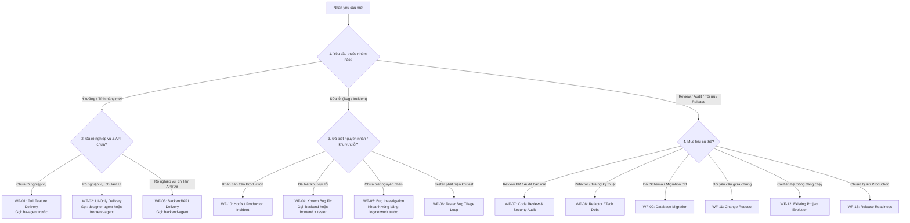

### Bảng Phản xạ Nhanh (10 Giây)
- **Task cực nhỏ (< 30 phút, sửa 1 nhãn text, chỉnh padding, sửa 1 dòng điều kiện rõ ràng)**: **KHÔNG** chạy quy trình đa Agent. Giao thẳng cho `frontend-agent` hoặc `backend-agent` xử lý trong 1 lượt.
- **Mọi tính năng có đụng tới tiền bạc, phê duyệt (Approval), phân quyền phòng ban/chi nhánh**: **BẮT BUỘC** đi qua `ba-agent` (chốt rule) $\to$ `backend-agent` $\to$ `security-agent` (kiểm tra BOLA/IDOR) $\to$ `tester-agent`.

---

## Báo cáo Khảo sát Hệ thống Hiện có (System Inventory)

Kết quả khảo sát thực tế tại workspace `d:\AI AGENT`:

### 1. Phân định Fact / Assumption / Recommendation

| Phân loại | Nội dung chi tiết |
| :--- | :--- |
| **FACT (Đã xác minh 100% từ cấu hình)** | 1. **6 Agent Rules** tại `.agent/rules/` (đều đặt chế độ `trigger: manual` — chỉ kích hoạt khi gọi):<br/>   - `ba-agent.md` (Senior Product & Technical Business Analyst)<br/>   - `designer-agent.md` (Lead Product Designer, Design Systems & Figma Architect)<br/>   - `frontend-agent.md` (Principal Frontend & UI/UX Engineer)<br/>   - `backend-agent.md` (Lead Backend & Distributed Systems Architect)<br/>   - `security-agent.md` (Principal Application Security Engineer)<br/>   - `tester-agent.md` (Lead QA Automation & SDET Engineer)<br/>2. **36 Thư mục Skills** tại `.agent/skills/` (đồng bộ với `.skill/` và `~/.gemini/config/skills/`):<br/>   - 25 skills từ bộ `addyosmani/agent-skills`<br/>   - 1 skill `security-audit` từ Cloudflare (`cloudflare/security-audit-skill`)<br/>   - 4 skills từ Figma MCP (`figma-use`, `figma-generate-design`, `figma-design-to-code` và bản alias `implement-design`)<br/>   - 1 skill `ui-ux-pro-max` từ `nextlevelbuilder/ui-ux-pro-max-skill`<br/>   - 3 skills thiết kế/tiện ích (`taste-skill` mang tên `design-taste-frontend`, `frontend-design`, `find-skills`)<br/>   - 2 skills tài liệu/bàn giao (`sop-generator`, `handover-report-generator`)<br/>3. **7 Tài liệu Tham chiếu Chuẩn (Checklists)** tại `.agent/references/`:<br/>   - `accessibility-checklist.md`, `definition-of-done.md`, `observability-checklist.md`, `orchestration-patterns.md`, `performance-checklist.md`, `security-checklist.md`, `testing-patterns.md`.<br/>4. **Mã nguồn ứng dụng (Application Source Code)**: Hiện tại `d:\AI AGENT` là **Agent Hub / Workspace cấu hình trung tâm**, chưa chứa mã nguồn ứng dụng cụ thể (chưa có `package.json`, `.sln`, `.csproj`, hay `src/`). |
| **ASSUMPTION (Giả định cần lưu ý)** | - Khi áp dụng bộ Agent này vào dự án thực tế (ví dụ: Intranet Portal, hệ thống Purchasing với ASP.NET Core / EF Core / SQL Server hoặc React / Next.js), cấu hình `.agent/` này sẽ được đặt ở thư mục gốc của repository dự án đó.<br/>- Để sử dụng nhóm skill `figma-use`, `figma-generate-design`, `implement-design` và `browser-testing-with-devtools`, môi trường IDE cần được kết nối tương ứng với **Figma MCP Server** (`https://mcp.figma.com/mcp`) và **Chrome DevTools MCP** (`Chưa xác minh` trạng thái kết nối MCP runtime trong phiên hiện tại). |
| **RECOMMENDATION (Khuyến nghị vận hành)** | - Duy trì cơ chế `trigger: manual` cho cả 6 Agent Rules để tránh nạp chồng chéo ngữ cảnh.<br/>- Tổ chức thư mục tài liệu bàn giao chuẩn trong mỗi dự án: `docs/specs/`, `docs/contracts/`, `docs/audits/`, `docs/releases/` và file `DESIGN.md` ở gốc dự án. |

---

## Chương 1 — Executive Guide (Kiến trúc Vận hành Tổng thể)

### 1.1. Mô hình Kiến trúc Điều phối (Human-in-the-Loop Orchestration)

Hệ thống của bạn hoạt động theo mô hình **Hub-and-Spoke (Trung tâm & Vệ tinh)**. Trong đó:
- **Bạn (Project Owner / Orchestrator)** là trung tâm ra quyết định và phê duyệt tại các cổng kiểm soát (Quality Gates).
- **6 Agent chuyên môn** đóng vai trò là 6 Trưởng bộ phận kỹ thuật độc lập, giao tiếp với nhau thông qua **Hợp đồng Bàn giao (Artifacts/Files)** thay vì nói chuyện tự do không kiểm soát.

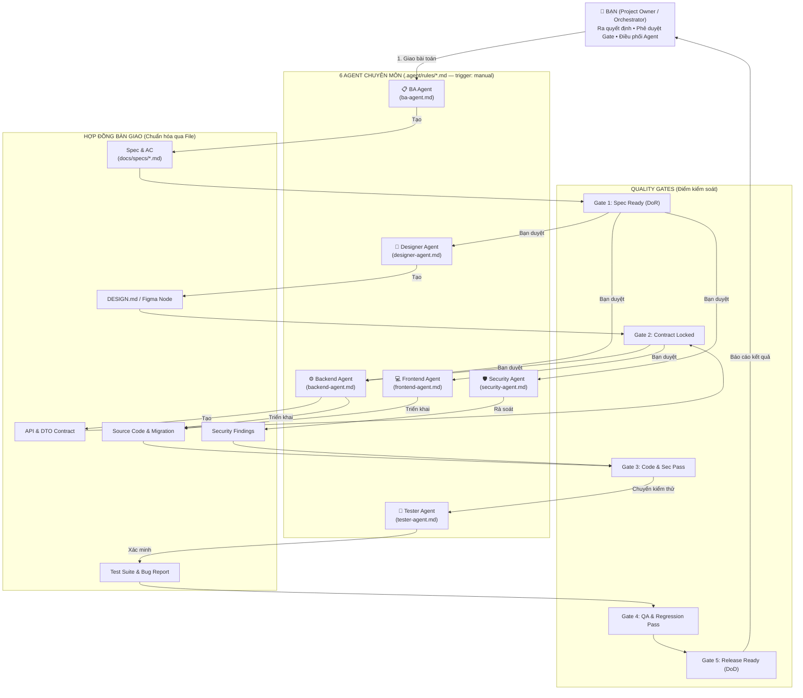

### 1.2. Năm Nguyên tắc Vận hành Cốt lõi (Bắt buộc)
1. **Không chạy toàn bộ Agent cho mọi yêu cầu (Right-Sizing)**: Chỉ gọi Agent khi đầu ra (Artifact) của Agent đó thực sự cần thiết cho bước tiếp theo.
2. **Một Chủ trì — Một Đầu việc (Single Owner per Task)**: Tại một thời điểm, mỗi file hoặc mỗi hợp đồng dữ liệu chỉ có **duy nhất 1 Agent** có quyền ghi/chỉnh sửa.
3. **Giao tiếp qua File, không giao tiếp bằng trí nhớ (Artifact-Driven Handover)**: Agent sau đọc file kết quả đã được duyệt của Agent trước (`spec.md`, `DESIGN.md`, `api-contract.md`), tránh truyền miệng dài dòng gây trôi ngữ cảnh (context drift).
4. **Dừng tại Cổng Kiểm soát (Stop-at-Gate)**: Không Agent nào được phép tự ý nhảy cóc từ khâu làm rõ yêu cầu sang viết code hoặc tự ý sửa code nghiệp vụ khi đang làm nhiệm vụ kiểm thử/bảo mật.
5. **Bằng chứng thực tế trên hết (Evidence over Claims)**: Lời tuyên bố *"Tôi đã sửa xong / Test đã pass"* của Agent không có giá trị nghiệm thu nếu không kèm log chạy lệnh thực tế, danh sách file thay đổi và kết quả kiểm chứng.

---

## Chương 2 — Agent & Skill Catalog (Danh mục Tra cứu & Ma trận RACI)

### 2.1. Phân biệt 4 Khái niệm Cốt lõi

| Khái niệm | Bản chất | Ví dụ trong Workspace |
| :--- | :--- | :--- |
| **1. Người Phê duyệt (Human Approver)** | Là **Bạn**. Người duy nhất có quyền chốt quyết định nghiệp vụ, chấp nhận rủi ro bảo mật, duyệt thay đổi phạm vi (Scope) và cho phép phát hành (Release). | Bạn duyệt mục `[Assumption]` của BA hoặc duyệt phương án migration DB của Backend. |
| **2. Cơ chế Điều phối (Orchestrator)** | Là **Quy trình trong Playbook này + Khả năng điều phối phiên làm việc**. Không cần cài thêm một file `orchestrator-agent.md` riêng gây tốn token; chính bạn dùng Playbook này (hoặc chỉ thị cho Agent chính gọi Subagent) để điều phối. | Bạn chọn `WF-01` và lần lượt kích hoạt `@ba-agent.md` $\to$ `@backend-agent.md`. |
| **3. Agent Role (`.agent/rules/*.md`)** | Là **Chuyên gia chịu trách nhiệm chính** về một mảng công việc, có tiêu chuẩn chất lượng (Standards) và ranh giới cấm (Guardrails) rõ ràng. | `backend-agent.md`, `tester-agent.md`. |
| **4. Skill (`.agent/skills/*/SKILL.md`)** | Là **Cẩm nang quy trình / Công cụ chuyên biệt (Runbook)** được Agent mở ra đọc khi cần thực hiện một tác vụ cụ thể. | `spec-driven-development`, `security-audit`, `test-driven-development`. |

---

### 2.2. Danh mục 6 Agent Chuyên môn (Đã xác minh)

| Agent Rule | Vai trò & Trách nhiệm chính | Khi nào dùng | Input cần có | Output bắt buộc | Khi KHÔNG cần dùng |
| :--- | :--- | :--- | :--- | :--- | :--- |
| **[`ba-agent.md`](file:///d:/AI%20AGENT/.agent/rules/ba-agent.md)** | **Senior Product & Technical BA**: Phân tích yêu cầu, đánh giá tác động hiện trạng, viết Spec/PRD, bẻ nhỏ task, viết SOP & Handover. | Yêu cầu mới mơ hồ, tính năng phức tạp, thay đổi quy tắc nghiệp vụ/phân quyền. | Mô tả ý tưởng/vấn đề, codebase/spec hiện hữu. | Lightweight/Full Spec (`REQ` $\to$ `US` $\to$ `AC`), Danh sách `[Assumptions]`, Task Breakdown. | Sửa bug kỹ thuật thuần túy, chỉnh UI nhỏ, refactor nội bộ không đổi hành vi. |
| **[`designer-agent.md`](file:///d:/AI%20AGENT/.agent/rules/designer-agent.md)** | **Lead Product Designer & Figma Architect**: Định hình thẩm mỹ, quản trị Design System, tạo `DESIGN.md` hoặc thiết kế trên Figma MCP. | Xây dựng sản phẩm/màn hình mới cần định hình UI/UX, làm việc với Figma, tạo Design System. | Spec từ BA, yêu cầu thương hiệu, hoặc link file Figma. | File `DESIGN.md` (Tokens, Variants, Responsive rules) hoặc Frame/Node ID trên Figma. | Task chỉ làm Backend/API, sửa logic ngầm, hoặc dự án đã có sẵn UI component chỉ cần ghép nối đơn giản. |
| **[`frontend-agent.md`](file:///d:/AI%20AGENT/.agent/rules/frontend-agent.md)** | **Principal Frontend & UI/UX Engineer**: Hiện thực hóa giao diện thành code (React/Next/Vue...), quản lý state, tích hợp API, đảm bảo WCAG AA & Web Vitals. | Mọi tác vụ tạo mới, chỉnh sửa, tối ưu hoặc sửa lỗi giao diện người dùng. | Spec + `DESIGN.md`/Figma + API Contract (DTO). | Code UI hoàn chỉnh, xử lý đủ trạng thái (Loading, Error theo HTTP code, Empty, Success). | Task chỉ sửa Database, API ngầm, cronjob hoặc script hệ thống. |
| **[`backend-agent.md`](file:///d:/AI%20AGENT/.agent/rules/backend-agent.md)** | **Lead Backend & Distributed Systems Architect**: Thiết kế API, logic nghiệp vụ, Database schema/migration, phân quyền tài nguyên (chống IDOR), xử lý đồng thời (Concurrency/Idempotency). | Mọi tác vụ liên quan đến API, бизнес logic phía server, cơ sở dữ liệu, tích hợp hệ thống. | Spec & Business Rules từ BA, cấu trúc DB hiện tại. | API Contract (DTO/Interfaces), Code Server, File Migration an toàn. | Task chỉ chỉnh sửa giao diện tĩnh, CSS, animation hoặc copywriting trên UI. |
| **[`security-agent.md`](file:///d:/AI%20AGENT/.agent/rules/security-agent.md)** | **Principal AppSec Engineer**: Threat Modeling (STRIDE), rà soát phân quyền 3 cấp (RBAC, Object/IDOR, Scope/Department), audit lỗ hổng, kiểm chứng PoC an toàn. | Tính năng nhạy cảm (tiền bạc, phê duyệt, phân quyền, auth, upload file), review PR quan trọng, hoặc audit định kỳ. | Spec/Architecture (để Threat Modeling) hoặc Code/Diff (để Audit). | Báo cáo Security Findings (`confirmed` / `needs_validation` / `rejected`), đoạn code vá lỗi, kịch bản Regression Test. | Chỉnh sửa giao diện thuần túy (màu sắc, spacing), đổi nhãn text tĩnh không liên quan tới dữ liệu hay input. |
| **[`tester-agent.md`](file:///d:/AI%20AGENT/.agent/rules/tester-agent.md)** | **Lead QA Automation & SDET**: Thiết kế test theo rủi ro (Risk-Based), viết Unit/Integration (DB thật)/E2E test, tái hiện và báo cáo bug, kiểm thử hồi quy trước release. | Sau khi có Spec/Contract (để chuẩn bị Test Plan) và sau khi Dev code xong (để chạy test & nghiệm thu). | Spec (AC), API Contract, và Code đã triển khai. | Test Plan, Code Automation Test (Unit/Integration/E2E), Bug Report chuẩn 5 mục, Xác nhận Release Gate. | Khi mới ở bước lên ý tưởng sơ bộ hoặc chỉ viết tài liệu nội bộ không có code thực thi. |

---

### 2.3. Danh mục 36 Skills (Phân nhóm theo Chức năng & Agent sử dụng)

> **Lưu ý quan trọng**: Trong thư mục `.agent/skills/` có 36 thư mục, trong đó `implement-design` và `figma-design-to-code` là 2 bản định danh song song của cùng một quy trình chuyển Figma sang Code (nhằm đảm bảo tương thích với mọi lệnh gọi), và thư mục `taste-skill` có định danh nội bộ là `design-taste-frontend`.

#### Nhóm A — Khai thác Yêu cầu, Đặc tả, Lập kế hoạch & Bàn giao (6 Skills)

| Tên Skill | Chức năng thực tế | Khi nào nên gọi | Agent hưởng lợi chính | Điều kiện / Lưu ý |
| :--- | :--- | :--- | :--- | :--- |
| [`interview-me`](file:///d:/AI%20AGENT/.agent/skills/interview-me/SKILL.md) | Phỏng vấn từng câu hỏi một để làm rõ yêu cầu mơ hồ (đến khi đạt ~95% độ rõ ràng). | Khi yêu cầu ban đầu quá ngắn ("Làm tính năng mua hàng") và chưa rõ đối tượng, quy trình. | `ba-agent` | Dừng hỏi ngay khi đã đủ thông tin viết Spec. |
| [`idea-refine`](file:///d:/AI%20AGENT/.agent/skills/idea-refine/SKILL.md) | Mở rộng và phản biện ý tưởng (Divergent & Convergent thinking) trước khi chốt phương án. | Khi muốn tìm giải pháp tốt hơn hoặc stress-test một ý tưởng sản phẩm mới. | `ba-agent`, `designer-agent` | Không dùng cho các yêu cầu đã chốt cứng quy trình. |
| [`spec-driven-development`](file:///d:/AI%20AGENT/.agent/skills/spec-driven-development/SKILL.md) | Xây dựng tài liệu đặc tả kỹ thuật (PRD/Spec) chuẩn mực trước khi viết code. | Bắt đầu tính năng mới hoặc thay đổi lớn cần tài liệu hóa (`docs/specs/*`). | `ba-agent` | Có thể rút gọn thành Lightweight Spec nếu task nhỏ. |
| [`planning-and-task-breakdown`](file:///d:/AI%20AGENT/.agent/skills/planning-and-task-breakdown/SKILL.md) | Chia nhỏ Spec thành danh sách các tác vụ (atomic tasks) có thứ tự phụ thuộc rõ ràng. | Sau khi Spec đã được duyệt (Gate 1), cần chia việc cho Backend/Frontend. | `ba-agent`, `backend-agent`, `frontend-agent` | Không cần gọi nếu task chỉ sửa 1-2 file đơn giản. |
| [`context-engineering`](file:///d:/AI%20AGENT/.agent/skills/context-engineering/SKILL.md) | Nén, lọc và đóng gói ngữ cảnh (Context Pack) tinh gọn trước khi chuyển giao giữa các Agent. | Khi chuẩn bị chuyển từ BA sang Dev hoặc khi cuộc hội thoại bắt đầu dài. | Mọi Agent (đặc biệt `ba-agent`) | Giúp giảm tiêu hao token và chống ảo giác (hallucination). |
| [`sop-generator`](file:///d:/AI%20AGENT/.agent/skills/sop-generator/SKILL.md) | Tạo Quy trình vận hành chuẩn (SOP), User Manual, Runbook từng bước từ luồng nghiệp vụ. | Khi người dùng yêu cầu viết tài liệu hướng dẫn sử dụng hoặc vận hành hệ thống. | `ba-agent` | Chỉ gọi khi có yêu cầu xuất tài liệu SOP/Manual. |
| [`handover-report-generator`](file:///d:/AI%20AGENT/.agent/skills/handover-report-generator/SKILL.md) | Tổng hợp toàn bộ lịch sử phiên làm việc thành Báo cáo bàn giao 5 mục (Executive Summary, Decisions, Blockers, Deliverables, Next Actions). | Cuối ca làm việc, trước khi đóng phiên chat dài, hoặc khi bàn giao giữa các giai đoạn lớn. | Mọi Agent | Chỉ gọi khi kết thúc chặng hoặc người dùng yêu cầu tóm tắt bàn giao. |

#### Nhóm B — Thiết kế UI/UX, Design System & Tích hợp Figma MCP (6 Skills)

| Tên Skill | Chức năng thực tế | Khi nào nên gọi | Agent hưởng lợi chính | Điều kiện / Lưu ý |
| :--- | :--- | :--- | :--- | :--- |
| [`ui-ux-pro-max`](file:///d:/AI%20AGENT/.agent/skills/ui-ux-pro-max/SKILL.md) | Cơ sở dữ liệu thiết kế cục bộ (79 styles, 192 bảng màu theo ngành, 74 font pairings, 119 UX guidelines, 22 stacks) + script Python sinh `MASTER.md`. | Khi cần chọn bảng màu theo ngành, cặp font, tra cứu UX rule theo stack hoặc tạo Design System mới. | `designer-agent`, `frontend-agent` | Cần Python 3.x nếu chạy script `search.py` cục bộ; có thể đọc trực tiếp `references/` nếu không chạy script. |
| [`design-taste-frontend`](file:///d:/AI%20AGENT/.agent/skills/taste-skill/SKILL.md) *(thư mục `taste-skill`)* | Định hướng nghệ thuật (Art Direction) cao cấp từ 247 trang web đạt giải thưởng; chống thiết kế AI rập khuôn (anti-slop). | Khi thiết kế hoặc làm mới Landing Page, Marketing Site, hoặc nâng tầm thẩm mỹ cho Dashboard/App. | `designer-agent`, `frontend-agent` | **Tránh gọi chồng chéo** cùng lúc với `frontend-design` để không xung đột quy tắc CSS. |
| [`frontend-design`](file:///d:/AI%20AGENT/.agent/skills/frontend-design/SKILL.md) | Hướng dẫn thiết kế giao diện có chủ đích, chọn typography và bố cục nhanh gọn. | Khi cần định hình nhanh giao diện cho màn hình/component đơn lẻ mà không cần tra cứu thư viện lớn của `taste-skill`. | `frontend-agent`, `designer-agent` | Dùng thay thế nhẹ nhàng cho `design-taste-frontend` ở các task nhỏ. |
| [`figma-use`](file:///d:/AI%20AGENT/.agent/skills/figma-use/SKILL.md) | Quy tắc bắt buộc khi dùng công cụ `use_figma` (Figma Plugin API) để đọc/ghi node, tạo Auto Layout, Variables, Variants. | **Bắt buộc gọi trước mọi lệnh `use_figma`** khi thao tác với file Figma. | `designer-agent`, `frontend-agent` | Phụ thuộc: Cần kết nối **Figma MCP Server**. Không gọi nếu dự án không dùng Figma. |
| [`figma-generate-design`](file:///d:/AI%20AGENT/.agent/skills/figma-generate-design/SKILL.md) | Quy trình dựng hoặc cập nhật màn hình trên Figma từ code hoặc từ mô tả bằng cách tái sử dụng Design System. | Khi muốn vẽ màn hình mới lên Figma hoặc đồng bộ từ Code ngược lên Figma (đi kèm `figma-use`). | `designer-agent`, `frontend-agent` | Phụ thuộc: **Figma MCP Server** + `figma-use`. |
| [`implement-design`](file:///d:/AI%20AGENT/.agent/skills/implement-design/SKILL.md) / [`figma-design-to-code`](file:///d:/AI%20AGENT/.agent/skills/figma-design-to-code/SKILL.md) | Quy trình bắt buộc trước khi gọi `get_design_context` để chuyển thiết kế từ Figma sang code chuẩn 1:1. | Khi có link Figma/Node ID và cần code giao diện từ thiết kế đó. | `frontend-agent`, `designer-agent` | Phụ thuộc: **Figma MCP Server**. Hai tên này là một; chỉ cần nạp 1 trong 2. |

#### Nhóm C — Kiến trúc, Triển khai Code & Nâng cấp Hệ thống (9 Skills)

| Tên Skill | Chức năng thực tế | Khi nào nên gọi | Agent hưởng lợi chính | Điều kiện / Lưu ý |
| :--- | :--- | :--- | :--- | :--- |
| [`api-and-interface-design`](file:///d:/AI%20AGENT/.agent/skills/api-and-interface-design/SKILL.md) | Thiết kế REST/GraphQL API, hợp đồng kiểu dữ liệu (DTO/Type Contracts), phân định ranh giới module và xử lý lỗi chuẩn. | Trước khi viết code Backend hoặc khi cần chốt API Contract giữa Backend và Frontend. | `backend-agent`, `frontend-agent` | Đầu ra dùng làm điều kiện qua Gate 2. |
| [`frontend-ui-engineering`](file:///d:/AI%20AGENT/.agent/skills/frontend-ui-engineering/SKILL.md) | Xây dựng hệ thống UI component chuẩn production, quản lý state, xử lý 5 trạng thái dữ liệu, đảm bảo WCAG a11y. | Khi bắt tay vào viết code giao diện (React, Next.js, Vue, Angular...). | `frontend-agent` | Kết hợp với `accessibility-checklist.md`. |
| [`incremental-implementation`](file:///d:/AI%20AGENT/.agent/skills/incremental-implementation/SKILL.md) | Triển khai code theo từng lát cắt mỏng (thin verifiable slices), kiểm chứng từng bước thay vì viết hàng nghìn dòng một lúc. | Khi làm tính năng chạm vào nhiều hơn 1 file hoặc thực thi từng task trong kế hoạch. | `backend-agent`, `frontend-agent` | Kỹ năng nền tảng khi viết code mới. |
| [`source-driven-development`](file:///d:/AI%20AGENT/.agent/skills/source-driven-development/SKILL.md) | Đối chiếu quyết định kỹ thuật với tài liệu chính thức (official docs) của framework/library, tránh dùng API lỗi thời. | Khi làm việc với thư viện mới, nâng cấp phiên bản hoặc cấu hình phức tạp. | `backend-agent`, `frontend-agent` | Tránh việc AI tự bịa hàm không tồn tại. |
| [`code-simplification`](file:///d:/AI%20AGENT/.agent/skills/code-simplification/SKILL.md) | Tái cấu trúc (Refactor) làm sạch và đơn giản hóa mã nguồn mà **không làm thay đổi hành vi nghiệp vụ**. | Khi thực hiện workflow Refactor (`WF-08`) hoặc dọn dẹp code sau khi test đã xanh. | `backend-agent`, `frontend-agent` | Bắt buộc có test bảo vệ trước và sau khi chạy. |
| [`deprecation-and-migration`](file:///d:/AI%20AGENT/.agent/skills/deprecation-and-migration/SKILL.md) | Quản lý việc loại bỏ code cũ, nâng cấp API hoặc **Migration Database không gây downtime (Expand/Contract pattern)**. | Khi thay đổi cấu trúc bảng DB (`WF-09`), đổi tên cột, hoặc nâng cấp phiên bản API đang có client sử dụng. | `backend-agent` | Bắt buộc dùng khi sửa đổi schema có dữ liệu thật. |
| [`performance-optimization`](file:///d:/AI%20AGENT/.agent/skills/performance-optimization/SKILL.md) | Đo đạc, tìm điểm nghẽn và tối ưu hiệu năng (Database query, N+1, caching, bundle size, Core Web Vitals). | Khi xử lý yêu cầu tối ưu tốc độ hoặc khi phát hiện truy vấn chậm. | `backend-agent`, `frontend-agent` | Tuân thủ nguyên tắc: Đo đạc trước — Tối ưu đúng chỗ nghẽn. |
| [`observability-and-instrumentation`](file:///d:/AI%20AGENT/.agent/skills/observability-and-instrumentation/SKILL.md) | Bổ sung Structured Logging, Correlation ID, Metrics, Tracing và Health Checks. | Khi xây dựng luồng nghiệp vụ quan trọng (thanh toán, duyệt đơn, tích hợp bên thứ 3) hoặc chuẩn bị lên Production. | `backend-agent` | Kết hợp với `observability-checklist.md`. |
| [`documentation-and-adrs`](file:///d:/AI%20AGENT/.agent/skills/documentation-and-adrs/SKILL.md) | Ghi lại Quyết định Kiến trúc (Architecture Decision Records - ADR) và tài liệu hóa API/Module. | Khi chốt một lựa chọn kiến trúc có đánh đổi (trade-off) hoặc khi thay đổi API công khai. | `ba-agent`, `backend-agent` | Ngắn gọn, tập trung vào lý do *"Tại sao chọn phương án này"*. |

#### Nhóm D — Kiểm thử, Chất lượng, Bảo mật & Phát hành (13 Skills + 2 Meta Skills)

| Tên Skill | Chức năng thực tế | Khi nào nên gọi | Agent hưởng lợi chính | Điều kiện / Lưu ý |
| :--- | :--- | :--- | :--- | :--- |
| [`test-driven-development`](file:///d:/AI%20AGENT/.agent/skills/test-driven-development/SKILL.md) | Phát triển dựa trên kiểm thử theo vòng lặp Red-Green-Refactor; viết Unit, Integration và E2E tests. | Khi viết test cho tính năng mới hoặc viết test tái hiện bug trước khi sửa. | `tester-agent`, `backend-agent`, `frontend-agent` | Kết hợp với `testing-patterns.md`. |
| [`browser-testing-with-devtools`](file:///d:/AI%20AGENT/.agent/skills/browser-testing-with-devtools/SKILL.md) | Kiểm thử trực tiếp trên trình duyệt thật qua Chrome DevTools MCP (kiểm tra DOM, Console errors, Network requests). | Khi kiểm thử giao diện, bắt lỗi UI hoặc điều tra bug giữa Frontend và Backend. | `tester-agent`, `frontend-agent` | Phụ thuộc: Cần cấu hình **Chrome DevTools MCP**. |
| [`debugging-and-error-recovery`](file:///d:/AI%20AGENT/.agent/skills/debugging-and-error-recovery/SKILL.md) | Quy trình điều tra và khoanh vùng nguyên nhân gốc rễ (Root-Cause Analysis) một cách có hệ thống khi có lỗi. | Khi gặp bug chưa rõ nguyên nhân (`WF-05`), test fail bất thường hoặc lỗi build. | `tester-agent`, `backend-agent`, `frontend-agent` | Chống sửa mò (shotgun debugging). |
| [`constraint-driven-development`](file:///d:/AI%20AGENT/.agent/skills/constraint-driven-development/SKILL.md) | Thiết lập ngưỡng chất lượng dự án thành hợp đồng văn bản (`CONSTRAINTS.md`) và ngăn chặn hành vi lách luật (`@ts-ignore`, `test.skip`). | Khi khởi tạo tiêu chuẩn dự án hoặc kiểm tra xem code mới có làm suy yếu chất lượng không. | `tester-agent`, `backend-agent`, `frontend-agent` | Bảo vệ chất lượng nền tảng (floor guard). |
| [`code-review-and-quality`](file:///d:/AI%20AGENT/.agent/skills/code-review-and-quality/SKILL.md) | Rà soát code đa chiều (Correctness, Security, Performance, Maintainability, Testing) trước khi merge. | Trong workflow Code Review (`WF-07`) hoặc trước khi qua Gate 3. | `security-agent`, `backend-agent`, `frontend-agent`, `tester-agent` | Phân loại rõ Blocking vs Non-blocking issues. |
| [`doubt-driven-development`](file:///d:/AI%20AGENT/.agent/skills/doubt-driven-development/SKILL.md) | Phản biện độc lập (Adversarial Review) đối với các quyết định hoặc thay đổi có rủi ro cao. | Khi làm việc với logic nhạy cảm (auth, phân quyền, tiền bạc, migration không thể đảo ngược). | `security-agent`, `backend-agent` | Lưu ý: Gọi từ phiên chính, không lồng bên trong một persona phụ. |
| [`security-and-hardening`](file:///d:/AI%20AGENT/.agent/skills/security-and-hardening/SKILL.md) | Gia cố bảo mật cho luồng xác thực, phân quyền, xử lý dữ liệu đầu vào (OWASP Top 10) và kiểm tra dependencies. | Khi thiết kế/code tính năng nhạy cảm hoặc review PR bảo mật thường nhật. | `security-agent`, `backend-agent` | Nhẹ và nhanh hơn so với full `security-audit`. |
| [`security-audit`](file:///d:/AI%20AGENT/.agent/skills/security-audit/SKILL.md) | Quy trình Audit bảo mật toàn diện 6 giai đoạn của Cloudflare (Reconnaissance $\to$ Hunting $\to$ Validation $\to$ JSON Output $\to$ Verification $\to$ Reporting). | Khi yêu cầu **Audit bảo mật toàn diện codebase / Pen-test** và xuất báo cáo chuẩn. | `security-agent` | Kèm 2 script kiểm chứng bằng Node.js (`validate-coverage-ledger.cjs`, `validate-findings.cjs`). |
| [`git-workflow-and-versioning`](file:///d:/AI%20AGENT/.agent/skills/git-workflow-and-versioning/SKILL.md) | Quản lý nhánh Git, chia commit nguyên tử (atomic commits), viết PR description và đánh version SemVer. | Khi đóng gói code sau khi hoàn thành task hoặc chuẩn bị tạo PR/Release. | `backend-agent`, `frontend-agent` | Giữ lịch sử Git sạch và dễ rollback. |
| [`ci-cd-and-automation`](file:///d:/AI%20AGENT/.agent/skills/ci-cd-and-automation/SKILL.md) | Thiết lập và tối ưu đường ống CI/CD (GitHub Actions, GitLab CI...), tự động hóa cổng kiểm tra chất lượng. | Khi cài đặt hoặc sửa đổi pipeline build/test/deploy. | `backend-agent`, `tester-agent` | Chỉ gọi khi làm việc với cấu hình CI/CD. |
| [`shipping-and-launch`](file:///d:/AI%20AGENT/.agent/skills/shipping-and-launch/SKILL.md) | Checklist chuẩn bị lên Production, kế hoạch rollout theo giai đoạn và phương án Rollback khẩn cấp. | Trong workflow Release Readiness (`WF-13`) trước khi phát hành phiên bản. | `tester-agent`, `backend-agent` | Chốt chặn cuối cùng tại Gate 5. |
| [`using-agent-skills`](file:///d:/AI%20AGENT/.agent/skills/using-agent-skills/SKILL.md) & [`find-skills`](file:///d:/AI%20AGENT/.agent/skills/find-skills/SKILL.md) | Meta-skills hỗ trợ định tuyến kỹ năng và tìm kiếm/cài đặt thêm skill mới từ hệ sinh thái `npx skills`. | Khi bạn muốn tìm hiểu hoặc cài thêm skill bên ngoài. | Orchestrator | Không dùng trong quy trình phát triển tính năng thông thường. |

---

### 2.4. Ma trận Trách nhiệm RACI giữa 6 Agent và Bạn

- **R (Responsible)**: Chủ trì thực hiện và tạo ra Artifact.
- **A (Accountable)**: Người phê duyệt cuối cùng (**Luôn là Bạn** tại các cổng nghiệp vụ/rủi ro).
- **C (Consulted)**: Hỗ trợ, đóng góp góc nhìn chuyên môn hoặc phản biện (Review).
- **I (Informed)**: Nhận kết quả bàn giao để làm bước tiếp theo.

| Hạng mục Công việc | Bạn (Owner) | BA Agent | Designer Agent | Backend Agent | Frontend Agent | Security Agent | Tester Agent |
| :--- | :---: | :---: | :---: | :---: | :---: | :---: | :---: |
| **1. Làm rõ yêu cầu & Viết Spec / AC** | **A** | **R** | C | C | C | C *(nếu nhạy cảm)* | I |
| **2. Thiết kế UI/UX (`DESIGN.md` / Figma)** | **A** | C | **R** | I | C / I | - | I |
| **3. Thiết kế API Contract & DB Schema** | **A** | C | - | **R** | C / I | C *(phân quyền)* | I |
| **4. Triển khai Code Server & Migration** | I | - | - | **R** | I | C | I |
| **5. Triển khai Code Giao diện & State** | I | - | C | I | **R** | - | I |
| **6. Threat Modeling & Security Audit** | **A** | I | - | C *(sửa lỗi)* | C *(sửa lỗi)* | **R** | I *(viết test)* |
| **7. Viết Test, Chạy Regression & Báo Bug** | I | C *(đối chiếu AC)* | C *(đối chiếu UI)* | C *(sửa bug)* | C *(sửa bug)* | C *(bug bảo mật)* | **R** |
| **8. Nghiệm thu & Phê duyệt Release** | **A** | I | - | C | C | C | **R** *(xác nhận Gate)* |

---

## Chương 3 — Decision Matrix: Chọn Quy trình nào?

Sử dụng bảng dưới đây để chọn ngay quy trình (Workflow) và tổ hợp Agent tối ưu cho **20 tình huống thực tế** (tránh gọi thừa Agent gây tốn thời gian và chi phí token):

| # | Loại yêu cầu thực tế | Quy trình áp dụng | Agent Chủ trì (R) | Agent Hỗ trợ / Kế tiếp | Có cần Security? | Có cần Tester? | Lý do Gọi / Không gọi Agent |
| :-: | :--- | :--- | :--- | :--- | :--- | :--- | :--- |
| **1** | **Ý tưởng mới, chưa rõ nghiệp vụ** | **WF-01** *(Giai đoạn 1–2)* | `ba-agent` | `designer-agent` *(nếu cần hình dung UI)* | Khi liên quan Auth, Tiền, Phân quyền | Chưa cần chạy test, chỉ nhận Spec | Chưa rõ yêu cầu mà gọi Backend/Frontend ngay sẽ dẫn đến code sai phải đập đi xây lại. |
| **2** | **Xây dựng chức năng mới hoàn chỉnh (End-to-End)** | **WF-01** *(Full Feature Delivery)* | `ba-agent` $\to$ `backend` + `frontend` | `designer`, `security`, `tester` | **Có** (nếu có phân quyền / dữ liệu nhạy cảm) | **Bắt buộc** | Đi đủ luồng chuẩn: Chốt Spec $\to$ Chốt Contract $\to$ Code song song $\to$ Kiểm thử. |
| **3** | **Chỉ cần viết tài liệu Spec, PRD hoặc SOP vận hành** | **WF-01** *(Chỉ bước BA)* | `ba-agent` | Không cần | Không | Không | Tác vụ thuần tài liệu (`spec-driven-development` hoặc `sop-generator`), gọi Dev/QA là lãng phí. |
| **4** | **Chỉ cần thiết kế Figma hoặc tạo file `DESIGN.md`** | **WF-02** *(Nhánh Thiết kế)* | `designer-agent` | `ba-agent` *(nếu luồng màn hình chưa rõ)* | Không | Không | Tập trung tạo tài sản thiết kế (`DESIGN.md` / Figma Frame) để chuẩn bị cho giai đoạn sau. |
| **5** | **Chỉ cần chuyển thiết kế Figma có sẵn thành Code UI** | **WF-02** *(Nhánh Figma-to-Code)* | `frontend-agent` | `tester-agent` *(kiểm tra UI/a11y)* | Không *(trừ khi có xử lý token/XSS)* | Có *(kiểm tra hiển thị & responsive)* | Đã có Figma rõ ràng; `frontend-agent` dùng `implement-design` chuyển thẳng sang code, không cần gọi lại Designer. |
| **6** | **Chỉ tạo thêm màn hình / UI mới (API đã có sẵn)** | **WF-02** *(UI-Only Delivery)* | `frontend-agent` *(hoặc `designer` nếu cần vẽ mới)* | `tester-agent` | Không | Có *(kiểm thử luồng UI & tích hợp API)* | Không đụng tới Server/DB nên bỏ qua hoàn toàn `backend-agent`. |
| **7** | **Chỉ xây dựng hoặc mở rộng Backend API / Logic ngầm** | **WF-03** *(Backend/API Delivery)* | `backend-agent` | `security-agent`, `tester-agent` | **Có** *(kiểm tra Auth/IDOR/Input)* | **Bắt buộc** *(Unit + Integration Test)* | Không có giao diện nên bỏ qua `designer-agent` và `frontend-agent`. |
| **8** | **Sửa bug đã biết rõ nguyên nhân & vị trí (FE hoặc BE)** | **WF-04** *(Known Bug Fix)* | `backend-agent` **hoặc** `frontend-agent` | `tester-agent` *(viết regression test)* | Chỉ khi bug liên quan đến quyền/bảo mật | **Bắt buộc** *(xác nhận lỗi đã hết)* | Đi thẳng vào Agent phụ trách khu vực lỗi để sửa nhanh trong phạm vi hẹp. |
| **9** | **Sửa bug nhưng chưa biết nằm ở Frontend hay Backend** | **WF-05** *(Bug Investigation)* | `tester-agent` **hoặc** Agent khu vực nghi vấn | `frontend-agent` + `backend-agent` | Khi nghi ngờ có can thiệp dữ liệu trái phép | **Có** *(cô lập bước tái hiện)* | Bắt buộc phân tích HTTP Request/Response và Console/Server Log để khoanh vùng trước, cấm cho 2 bên sửa mò cùng lúc. |
| **10** | **Tester phát hiện bug trong quá trình kiểm thử** | **WF-06** *(Tester Bug Triage Loop)* | `tester-agent` *(báo cáo)* $\to$ Dev *(sửa)* | `security-agent` *(nếu là lỗi phân quyền)* | Nếu là lỗi BOLA/IDOR/Auth | **Chủ trì** đóng/mở bug | Đảm bảo chu trình khép kín: Tái hiện $\to$ Giao đúng người $\to$ Sửa $\to$ Regression Test. |
| **11** | **Chỉ cần Review Code (PR/Diff Review)** | **WF-07** *(Nhánh Code Review)* | `backend` / `frontend` / `security` | `tester-agent` *(kiểm tra độ phủ test)* | **Có** *(nếu PR chạm vào API/Auth/Data)* | Có *(đánh giá chất lượng test đi kèm)* | Rà soát đa chiều bằng `code-review-and-quality` mà không tự ý sửa code khi chưa được yêu cầu. |
| **12** | **Audit bảo mật độc lập cho toàn bộ hoặc một phần dự án** | **WF-07** *(Nhánh Security Audit)* | `security-agent` | `backend-agent` *(cung cấp ngữ cảnh nếu cần)* | **Chủ trì 100%** | Phối hợp viết test sau khi vá lỗi | Chạy quy trình 6 bước của `security-audit` độc lập để tìm lỗ hổng thực tế. |
| **13** | **Refactor làm sạch code / Giảm nợ kỹ thuật** | **WF-08** *(Refactoring)* | `backend-agent` **hoặc** `frontend-agent` | `tester-agent` | Không *(trừ khi refactor module Auth)* | **Bắt buộc** *(đảm bảo không đổi hành vi)* | Không thay đổi nghiệp vụ nên không cần BA hay Designer; Tester giữ chốt chặn Regression. |
| **14** | **Thay đổi Database Schema / Migration dữ liệu** | **WF-09** *(Database Migration)* | `backend-agent` | `ba-agent` *(xác nhận dữ liệu)*, `tester-agent` | Khi liên quan dữ liệu nhạy cảm / PII | **Bắt buộc** *(kiểm tra tương thích & rollback)* | Rủi ro mất dữ liệu hoặc downtime cao, phải áp dụng `deprecation-and-migration` (Expand/Contract). |
| **15** | **Sự cố khẩn cấp trên Production (Hotfix)** | **WF-10** *(Hotfix / Incident)* | `backend` / `frontend` *(theo điểm gãy)* | `tester-agent`, `security-agent` | Nếu sự cố do bị tấn công / rò rỉ dữ liệu | **Bắt buộc** *(Smoke + Regression test)* | Ưu tiên khoanh vùng và khôi phục dịch vụ nhanh nhất, bỏ qua các thủ tục tài liệu rườm rà nhưng giữ chặt bước kiểm chứng. |
| **16** | **Khách hàng / Bạn đổi yêu cầu giữa lúc đang code** | **WF-11** *(Change Request)* | `ba-agent` | `designer`, `backend`, `frontend`, `tester` | Nếu thay đổi chạm vào quy tắc phân quyền | **Có** *(cập nhật AC & Test Case)* | Phải dừng code phần bị ảnh hưởng để BA đánh giá Impact Analysis và cập nhật Contract trước. |
| **17** | **Cải tiến, nâng cấp một dự án cũ đang vận hành** | **WF-12** *(Existing Project Evolution)* | `ba-agent` + `backend`/`frontend` | `tester-agent`, `security-agent` | Theo phạm vi thay đổi | **Bắt buộc** *(bảo vệ luồng cũ không vỡ)* | Đặt nguyên tắc *Context & Regression First* lên đầu: khảo sát kỹ hệ thống hiện hữu trước khi chạm vào code. |
| **18** | **Tối ưu hiệu năng (API chậm, DB nghẽn, UI giật lag)** | **WF-12** *(Nhánh Performance)* | `backend-agent` **hoặc** `frontend-agent` | `tester-agent` *(đo kiểm trước/sau)* | Khi có nguy cơ DoS / cạn kiệt tài nguyên | **Có** *(kiểm tra không làm sai lệch kết quả)* | Dùng `performance-optimization` đo đạc baseline trước, tối ưu đúng điểm nghẽn và đo lại. |
| **19** | **Chỉ cần viết hoặc chạy bổ sung bộ kiểm thử cho tính năng** | **WF-06 / Độc lập** | `tester-agent` | Không cần *(trừ khi phát hiện bug)* | Không | **Chủ trì 100%** | Giao thẳng cho `tester-agent` dùng `test-driven-development` đọc Spec và code hiện tại để viết test. |
| **20** | **Chuẩn bị phát hành phiên bản lên Production (Release)** | **WF-13** *(Release Readiness)* | `tester-agent` + `backend-agent` | `security-agent` | **Có** *(rà soát các finding còn mở)* | **Chủ trì** *(chốt Gate 4 & Gate 5)* | Kiểm tra toàn diện DoD, Migration script, Rollback plan và Monitoring trước khi bấm nút deploy. |

---

## Chương 4 — Workflow Library (13 Quy trình Chuẩn WF-01 đến WF-13)

### WF-01: Từ Ý tưởng đến Chức năng Hoàn chỉnh (Full Feature Delivery)
- **Khi nào sử dụng**: Khi bắt đầu một tính năng mới từ mô tả sơ bộ, liên quan đến cả nghiệp vụ, API/Database và giao diện người dùng.
- **Khi nào KHÔNG cần sử dụng**: Các chỉnh sửa nhỏ, chỉ làm UI tĩnh (`WF-02`), chỉ làm API (`WF-03`), hoặc sửa bug (`WF-04`).
- **Input cần có**: Mô tả ý tưởng/bài toán từ bạn + quyền truy cập codebase hiện tại (nếu có).

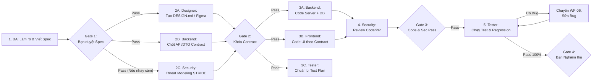

- **Các bước, Agent chịu trách nhiệm, Đầu ra & Điều kiện chuyển bước**:
  1. **Bước 1 — Khai thác & Đặc tả (`ba-agent`)**: Dùng `interview-me` (nếu mơ hồ) $\to$ `spec-driven-development`. **Đầu ra**: File `docs/specs/<feature>-spec.md` có mã `REQ` $\to$ `US` $\to$ `AC`, RBAC và danh sách `[Assumptions]`. **Điều kiện qua bước**: Đạt Gate 1 (Bạn giải quyết hết `[Assumptions]` và duyệt Spec).
  2. **Bước 2 — Thiết kế & Hợp đồng Kỹ thuật (Chạy song song)**:
     - `designer-agent`: Xuất `DESIGN.md` hoặc Figma Frame (bỏ qua nếu dùng lại hoàn toàn layout cũ).
     - `backend-agent`: Dùng `api-and-interface-design` xuất `docs/contracts/<feature>-api.md` (DTO, Endpoints, Error codes) + thiết kế DB schema.
     - `security-agent` *(theo rủi ro)*: Đánh giá nhanh các điểm phân quyền/IDOR trên thiết kế API.
     - **Điều kiện qua bước**: Đạt Gate 2 (Contract & Design thống nhất, không mâu thuẫn với Spec).
  3. **Bước 3 — Triển khai Song song (Parallel Execution)**:
     - `backend-agent`: Code logic server, migration, authorization và unit test tầng service.
     - `frontend-agent`: Code giao diện dựa trên `DESIGN.md` và mock dữ liệu theo đúng `api-contract.md`.
     - `tester-agent`: Soạn Test Cases (`TC-xx`) và chuẩn bị khung Integration/E2E test dựa trên AC và Contract.
  4. **Bước 4 — Tích hợp & Rà soát Bảo mật (`security-agent`)**: Khi code hoàn tất, `security-agent` dùng `code-review-and-quality` / `security-and-hardening` kiểm tra diff. **Đầu ra**: Xác nhận không có lỗi `Critical/High`.
  5. **Bước 5 — Kiểm thử & Nghiệm thu (`tester-agent`)**: Chạy bộ Unit, Integration (DB thật) và E2E test. Nếu có bug $\to$ kích hoạt `WF-06`.
- **Điểm cần Bạn quyết định**: Duyệt Spec tại **Gate 1**, duyệt thay đổi DB/Contract lớn tại **Gate 2**, và nghiệm thu tính năng tại **Gate 4**.
- **Điều kiện kết thúc**: Toàn bộ AC trong Spec đều có test tương ứng báo Pass, không còn bug Critical/High mở.
- **Lỗi điều phối thường gặp**: Cho `frontend-agent` và `backend-agent` nhảy vào code ngay khi chưa chốt `API Contract` ở Bước 2, dẫn đến lệch tên trường JSON phải sửa lại cả hai đầu.

---

### WF-02: Chỉ Xây dựng Giao diện (UI-Only Delivery)
- **Khi nào sử dụng**: Khi tạo mới hoặc nâng cấp màn hình/component mà Backend API đã có sẵn hoặc chỉ cần làm giao diện tĩnh/prototype.
- **Khi nào KHÔNG cần sử dụng**: Khi cần thay đổi cấu trúc DB hoặc thêm logic API mới ở phía server (`WF-01`).
- **Input cần có**: Yêu cầu màn hình + API Contract có sẵn (nếu có tích hợp) + Link Figma (nếu có).

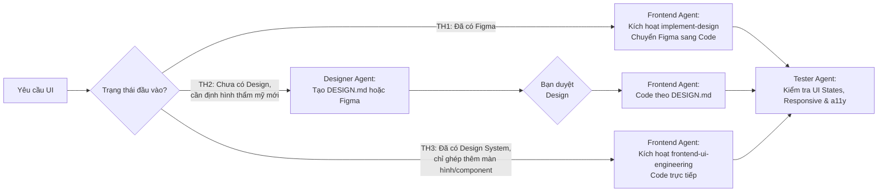

- **Phân định rõ ai chủ trì trong 5 trường hợp**:
  1. *Đã có Figma hoàn chỉnh*: **`frontend-agent` chủ trì** (nạp `implement-design` + `figma-use`), không cần gọi `designer-agent`.
  2. *Chưa có design, làm sản phẩm/trang mới cần định hình phong cách*: **`designer-agent` chủ trì** tạo `DESIGN.md` (hoặc vẽ Figma), sau khi bạn duyệt mới chuyển cho `frontend-agent`.
  3. *Chỉ cần mockup/prototype trên Figma*: **`designer-agent` chủ trì** 100%, kết thúc ngay sau khi bàn giao Figma Node ID.
  4. *Chỉ thêm 1 component/màn hình vào dự án đã có sẵn thư viện UI chuẩn*: **`frontend-agent` chủ trì** trực tiếp, tái sử dụng component hiện hữu.
  5. *Chỉ bổ sung UI States (Loading/Empty/Error), Responsive hoặc Accessibility*: **`frontend-agent` chủ trì**, `tester-agent` xác minh bằng `browser-testing-with-devtools`.
- **Đầu ra & Điều kiện kết thúc**: Giao diện hiển thị đúng trên Desktop/Mobile, xử lý đủ các trạng thái dữ liệu theo ngữ cảnh, không có lỗi đỏ trên Console, đạt chuẩn tương phản & điều hướng bàn phím (WCAG AA).
- **Lỗi điều phối thường gặp**: Gọi cả 3 skills (`design-taste-frontend`, `frontend-design`, `ui-ux-pro-max`) cùng một lúc cho 1 màn hình nhỏ làm rối loạn CSS tokens.

---

### WF-03: Chỉ Xây dựng Backend / API (Backend-Only Delivery)
- **Khi nào sử dụng**: Xây dựng REST/GraphQL API mới, background worker, tích hợp bên thứ 3 hoặc xử lý logic nghiệp vụ phía server không kèm thay đổi giao diện.
- **Khi nào KHÔNG cần sử dụng**: Khi thay đổi đòi hỏi sửa đổi đồng bộ cả màn hình người dùng (`WF-01`).
- **Input cần có**: Yêu cầu nghiệp vụ/Spec + Cấu trúc codebase & Database hiện tại.

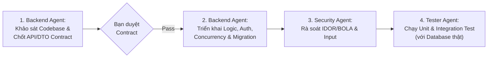

- **Các bước & Đầu ra**:
  1. **`backend-agent` (Thiết kế)**: Khảo sát kiến trúc hiện có, dùng `api-and-interface-design` xuất bản nháp DTO/Endpoint Contract + phương án phân quyền.
  2. **Bạn duyệt Contract (Gate 2)**: Chốt đường dẫn API, request/response payload và quy tắc nghiệp vụ.
  3. **`backend-agent` (Triển khai)**: Dùng `incremental-implementation` viết code, đảm bảo Resource-Based Authorization (chống IDOR), Concurrency Token / Idempotency (nếu là API ghi quan trọng), phân trang an toàn (`MaxPageSize`).
  4. **`security-agent` (Kiểm tra)**: Soi quyền truy cập cấp bản ghi/phòng ban và các câu lệnh truy vấn dữ liệu.
  5. **`tester-agent` (Kiểm chứng)**: Chạy Unit Test và Integration Test trên Test Database thật.
- **Điều kiện kết thúc**: API trả về đúng HTTP status codes & Standard Error Envelope, vượt qua toàn bộ test hợp lệ và test bị từ chối (401/403/400), tài liệu API Contract sẵn sàng bàn giao cho bên gọi.
- **Lỗi điều phối thường gặp**: Chỉ kiểm tra trường dữ liệu hợp lệ (DTO validation) mà quên kiểm tra xem người gọi có quyền thao tác trên bản ghi đó hay không (thiếu Resource-Based Authorization).

---

### WF-04: Sửa Bug đã biết Nguyên nhân hoặc Khu vực (Known Bug Fix)
- **Khi nào sử dụng**: Khi lỗi đã rõ thông báo (stack trace, vị trí file, hoặc biết chắc nằm ở UI hay API cụ thể).
- **Khi nào KHÔNG cần sử dụng**: Khi chưa biết lỗi nằm ở đâu (`WF-05`) hoặc khi yêu cầu thực chất là đòi thay đổi quy tắc nghiệp vụ mới (`WF-11`).
- **Input cần có**: Mô tả lỗi, bước tái hiện (Steps to Reproduce) và Expected vs Actual result.

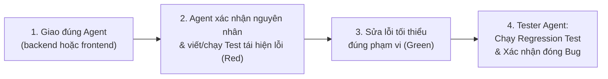

- **Các bước thực hiện**:
  1. **Giao việc trực tiếp**: Lỗi giao diện/hiển thị $\to$ `frontend-agent`; Lỗi tính toán/API/DB $\to$ `backend-agent`.
  2. **Tái hiện bằng Test (Red)**: Agent (hoặc phối hợp với `tester-agent`) tạo test case tái hiện đúng lỗi đó trước khi sửa.
  3. **Sửa lỗi trong phạm vi hẹp (Green)**: Chỉ sửa đúng nguyên nhân gốc, **tuyệt đối không tiện tay refactor các file xung quanh** ngoài phạm vi bug.
  4. **Kiểm chứng hồi quy (`tester-agent`)**: Chạy lại test vừa viết và các test lân cận để đảm bảo việc sửa lỗi không làm hỏng tính năng khác.
- **Điểm cần Bạn quyết định**: Chỉ cần can thiệp nếu việc sửa bug đòi hỏi thay đổi logic nghiệp vụ hoặc sửa cấu trúc Database.
- **Điều kiện kết thúc**: Test tái hiện lỗi chuyển từ Fail sang Pass, toàn bộ Regression suite liên quan báo Pass.
- **Lỗi điều phối thường gặp**: Sửa code xong báo "Đã xong" ngay mà không có Regression Test bảo vệ, dẫn đến lỗi tái phát ở bản sau.

---

### WF-05: Điều tra Bug chưa biết Nguyên nhân (Unknown Bug Investigation)
- **Khi nào sử dụng**: Khi hệ thống chạy sai (ví dụ: bấm nút không có phản hồi, số liệu lệch, thỉnh thoảng văng lỗi 500) nhưng chưa rõ lỗi do Frontend gửi sai, Backend tính sai hay dữ liệu DB bị bẩn.
- **Khi nào KHÔNG cần sử dụng**: Khi đã có stack trace chỉ thẳng vào dòng code bị lỗi (`WF-04`).
- **Input cần có**: Hiện tượng lỗi, thời điểm xảy ra, tài khoản/dữ liệu gặp lỗi, log hoặc ảnh chụp màn hình.

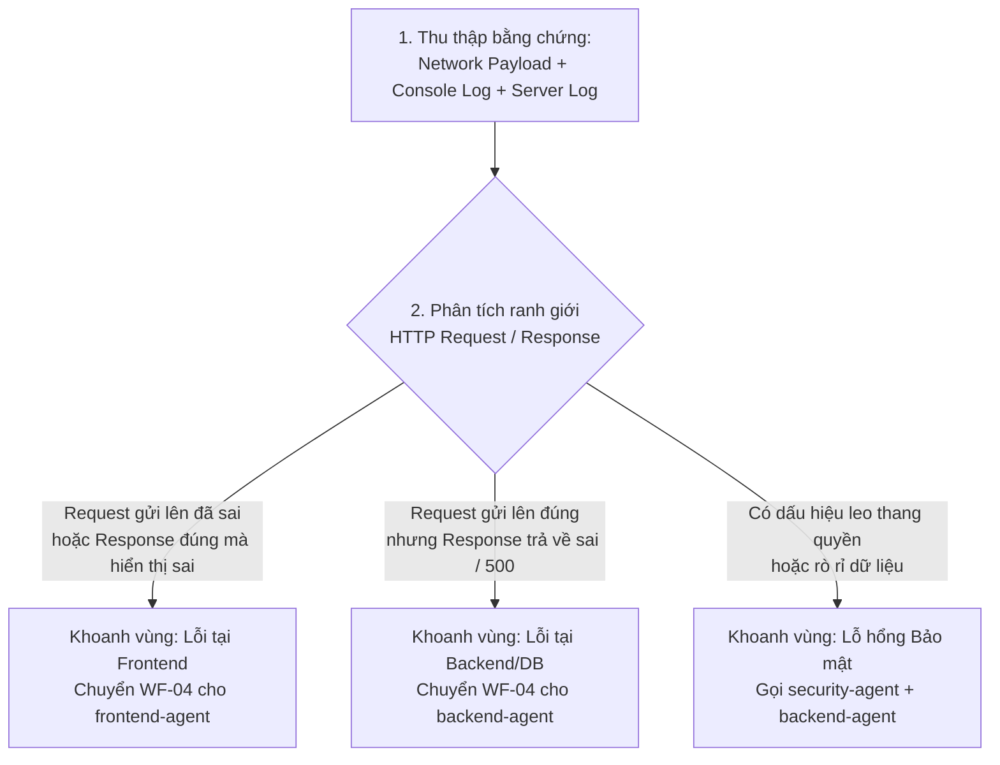

- **Các bước điều tra chuẩn (`debugging-and-error-recovery`)**:
  1. **Bước 1 — Cố định hiện trường (`tester-agent` hoặc Agent khu vực nghi vấn)**: Kiểm tra tại điểm giao cắt **HTTP Network Request & Response** (dùng `browser-testing-with-devtools` hoặc Server Log theo Correlation ID).
  2. **Bước 2 — Chia để trị (Binary Search)**:
     - Nếu Payload từ UI gửi lên đã thiếu/sai trường $\to$ Lỗi thuộc `frontend-agent`.
     - Nếu Payload gửi lên đúng chuẩn Contract nhưng API trả về lỗi hoặc lưu DB sai $\to$ Lỗi thuộc `backend-agent`.
  3. **Bước 3 — Xác nhận giả thuyết**: Đưa ra kết luận nguyên nhân gốc rễ (Root Cause) có dẫn chứng dòng code, sau đó chuyển sang `WF-04` để sửa.
- **Nguyên tắc cấm kỵ**: **Tuyệt đối không gọi `frontend-agent` và `backend-agent` cùng lúc sửa mò ở cả hai đầu** khi chưa xác định được lỗi nằm ở phía bên nào của HTTP Contract.
- **Điều kiện kết thúc**: Xác định chính xác file/dòng code gây lỗi kèm kịch bản tái hiện 100% và chuyển giao thành công sang `WF-04`.

---

### WF-06: Quy trình Khi Tester Phát hiện Bug (Tester Bug Triage & Resolution Loop)
- **Khi nào sử dụng**: Bắt buộc kích hoạt ngay khi `tester-agent` phát hiện bất kỳ sai lệch nào giữa kết quả thực tế (Actual) và đặc tả (Expected) trong quá trình kiểm thử.
- **Input cần có**: Kết quả chạy test thất bại (Failed Test / Log / Screenshot) + Spec/AC tương ứng.

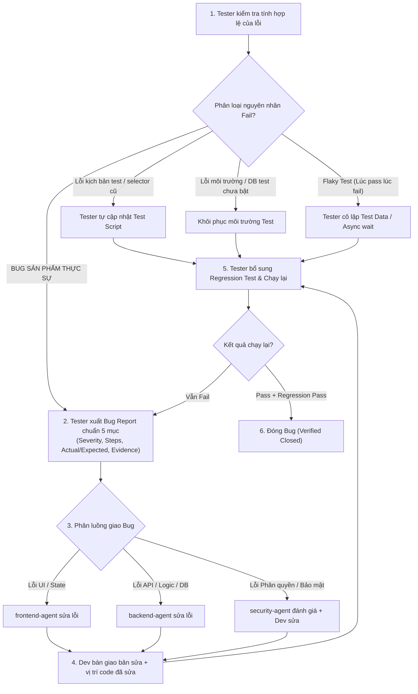

- **Chi tiết 8 bước bắt buộc**:
  1. **Sàng lọc ban đầu (`tester-agent`)**: Phân biệt rõ đây là **Bug sản phẩm thực sự** hay do:
     - *Lỗi Test Script*: Test viết sai kỳ vọng hoặc dùng selector không khớp.
     - *Lỗi Môi trường (Environment)*: Server chưa chạy, port bị chiếm, DB kết nối đứt.
     - *Flaky Test*: Test phụ thuộc dữ liệu dùng chung hoặc thiếu cơ chế chờ bất đồng bộ (`await`).
  2. **Xuất Bug Report chuẩn (`tester-agent`)**: Ghi rõ Severity (`Critical` / `High` / `Medium` / `Low`), môi trường, các bước tái hiện, Actual vs Expected (trích dẫn mã `AC-xx`), và gợi ý nguyên nhân gốc (Root-Cause Hint).
  3. **Giao đúng chủ sở hữu**: Bạn (hoặc Orchestrator) chuyển Bug Report cho đúng Agent chịu trách nhiệm (`frontend-agent`, `backend-agent`, hoặc kèm `security-agent` nếu liên quan đến lỗ hổng bảo mật).
  4. **Phân tích & Khắc phục (Developer Agent)**: Developer đọc Bug Report, tìm đúng nguyên nhân và sửa code trong phạm vi tối thiểu. **Cấm `tester-agent` tự ý nhảy vào sửa code nghiệp vụ của Dev**.
  5. **Review & Bổ sung Regression Test (`tester-agent`)**: Tester kiểm tra xem test case hiện tại đã đủ chặt để bắt lỗi đó chưa, bổ sung test case mới nếu cần và chạy lại.
  6. **Xử lý khi vẫn Fail**: Nếu chạy lại vẫn lỗi $\to$ Mở lại (Reopen) kèm log mới và quay lại Bước 4 (nếu quá 2 lần không thành công, báo cáo ngay cho Bạn để xem xét lại hướng tiếp cận).
  7. **Chạy Regression Suite liên quan**: Khi bug đã Pass, chạy toàn bộ nhóm test của module đó để chắc chắn việc vá lỗi không đẻ ra lỗi mới.
  8. **Đóng Bug hoặc Ghi nhận Rủi ro**: Chỉ đóng bug (`Verified Closed`) khi có bằng chứng test Pass. Nếu do giới hạn kỹ thuật chưa thể sửa ngay (ví dụ lỗi `Low`), phải được **Bạn phê duyệt** chuyển sang trạng thái `Known Issue / Accepted Risk`.

---

### WF-07: Code Review & Security Audit
- **Khi nào sử dụng**: Trước khi merge một nhánh tính năng quan trọng vào nhánh chính, hoặc khi cần rà soát bảo mật độc lập cho hệ thống.
- **Khi nào KHÔNG cần sử dụng**: Các thay đổi cấu hình định dạng (formatting) hoặc sửa chính tả tài liệu.
- **Input cần có**: Git Diff / PR hoặc đường dẫn thư mục mã nguồn cần audit + Spec/Contract liên quan.

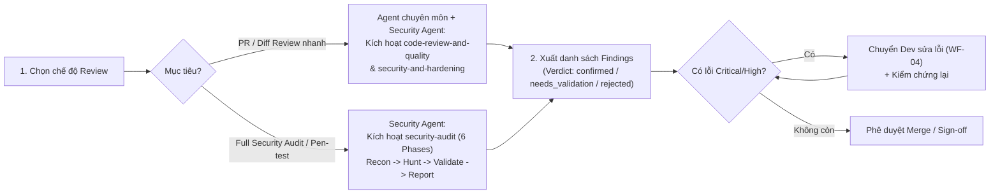

- **Các bước thực hiện**:
  1. **Review Chất lượng & Kiến trúc**: Agent cùng chuyên môn dùng `code-review-and-quality` kiểm tra tính đúng đắn, hiệu năng (N+1), khả năng bảo trì và độ bao phủ test.
  2. **Review Bảo mật (`security-agent`)**:
     - *Chế độ PR Review*: Kiểm tra phân quyền 3 cấp (RBAC, BOLA/IDOR, Department/Site Scope), Mass Assignment, Injection và lộ thông tin nhạy cảm.
     - *Chế độ Full Audit*: Chạy quy trình 6 bước của `security-audit`, kiểm chứng độc lập từng phát hiện và chạy script validator (`validate-findings.cjs`).
  3. **Phân loại & Khắc phục**: Mọi phát hiện phải gắn nhãn `confirmed` (có bằng chứng code rõ ràng) hoặc `needs_validation` (cần kiểm tra thêm), kèm mức độ `Critical / High / Medium / Low` hoặc `Hardening Note`.
  4. **Xác minh sau sửa (Re-verification)**: Các lỗi `Critical` và `High` bắt buộc phải được Developer sửa và `security-agent` + `tester-agent` xác nhận lại trước khi cho qua.
- **Lỗi điều phối thường gặp**: Báo cáo hàng loạt "lỗi lý thuyết" (False Positives) không có kịch bản khai thác thực tế làm mất thời gian của Developer.

---

### WF-08: Refactor / Trả nợ Kỹ thuật (Technical Debt Reduction)
- **Khi nào sử dụng**: Khi code hoạt động đúng nhưng cấu trúc rối rắm, trùng lặp nhiều, khó bảo trì và cần làm sạch bằng `code-simplification`.
- **Khi nào KHÔNG cần sử dụng**: Khi đang gấp rút vá lỗi sự cố Production (`WF-10`) hoặc khi code khu vực đó chưa có bất kỳ bài test nào bảo vệ.
- **Input cần có**: Khu vực code cần refactor + Bộ test hiện hữu.

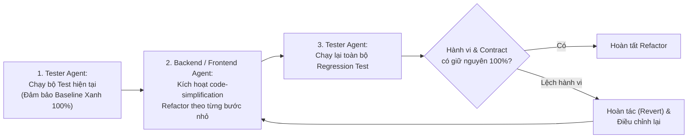

- **Nguyên tắc vàng**: **Refactor tuyệt đối không được thay đổi hành vi nghiệp vụ bên ngoài (External Behavior) hay phá vỡ API Contract**. Nếu khu vực cần refactor chưa có test, bắt buộc gọi `tester-agent` viết Characterization/Regression Test chụp lại hành vi hiện tại *trước* khi cho phép Developer chạm vào code.

---

### WF-09: Database Migration & Thay đổi Cấu trúc Dữ liệu (Data Change)
- **Khi nào sử dụng**: Khi thêm/sửa/xóa bảng, đổi tên cột, thay đổi kiểu dữ liệu, thêm rằng buộc Unique/Foreign Key hoặc chuyển đổi dữ liệu hàng loạt.
- **Input cần có**: Schema hiện tại, yêu cầu thay đổi dữ liệu và ước tính khối lượng bản ghi đang có.

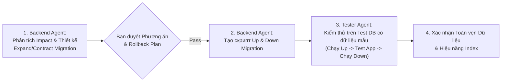

- **Các bước bắt buộc (`deprecation-and-migration`)**:
  1. **Phân tích tương thích ngược (Backward Compatibility)**: Nếu đổi tên cột hoặc xóa cột trên hệ thống đang chạy, không được `DROP` ngay lập tức mà phải dùng mô hình **Expand $\to$ Migrate $\to$ Contract** (Thêm cột mới $\to$ Đồng bộ dữ liệu $\to$ Chuyển code sang cột mới $\to$ Xóa cột cũ ở bản sau).
  2. **Thiết kế kịch bản Rollback (`Down`)**: Mọi migration phải có phương án hoàn tác an toàn nếu xảy ra sự cố.
  3. **Kiểm chứng trên dữ liệu thực tế giả lập (`tester-agent`)**: Không chỉ chạy migration trên bảng rỗng; phải seed dữ liệu mẫu (bao gồm cả trường hợp `NULL` hoặc dữ liệu biên) để chắc chắn lệnh `ALTER TABLE` không bị treo hoặc lỗi ràng buộc.

---

### WF-10: Xử lý Sự cố Khẩn cấp trên Production (Hotfix / Incident Response)
- **Khi nào sử dụng**: Khi hệ thống Production bị sập, lỗi luồng nghiệp vụ trọng yếu (không tạo được đơn, không duyệt được thanh toán) hoặc phát hiện lỗ hổng bảo mật đang bị khai thác.
- **Input cần có**: Cảnh báo sự cố, log lỗi từ Production, thời điểm phát sinh và bản release gần nhất.

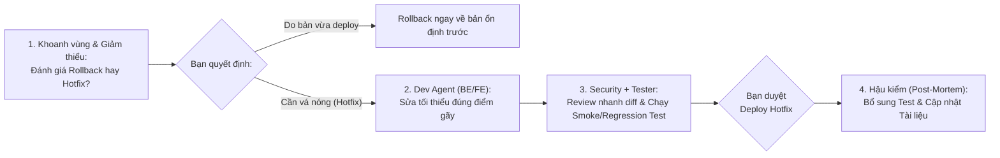

- **Quy tắc khẩn cấp**:
  - **Không mở rộng phạm vi**: Bản hotfix chỉ chứa những dòng code tối thiểu để dập tắt sự cố.
  - **Không bỏ qua bước kiểm chứng**: Dù gấp đến đâu cũng phải có ít nhất 1 test case xác nhận lỗi đã hết và chạy Smoke Test các luồng chính trước khi đưa lên Production.
  - **Hậu kiểm bắt buộc**: Sau khi hệ thống ổn định, gọi `tester-agent` bổ sung đầy đủ Regression Test để đóng lỗ hổng quy trình.

---

### WF-11: Xử lý Yêu cầu Thay đổi Giữa chừng (Mid-Flight Change Request)
- **Khi nào sử dụng**: Khi tính năng đang được thiết kế hoặc đang code dở dang thì bạn (hoặc Stakeholder) thay đổi quy tắc nghiệp vụ, thêm/bớt trường dữ liệu hoặc đổi luồng phê duyệt.
- **Input cần có**: Nội dung yêu cầu thay đổi + Các Artifacts đang làm dở (`Spec`, `DESIGN.md`, `API Contract`, `Code`).

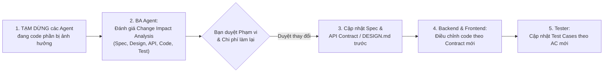

- **Lỗi điều phối thường gặp**: Truyền đạt thay đổi trực tiếp cho `frontend-agent` mà quên báo cho `backend-agent` và không cập nhật lại `Spec` / `API Contract`, khiến hệ thống rơi vào trạng thái "nửa cũ nửa mới" không khớp nhau.

---

### WF-12: Cải tiến & Mở rộng Dự án Đang Tồn tại (Existing Project Improvement & Evolution)
- **Khi nào sử dụng**: Khi tiếp nhận một codebase có sẵn (Brownfield project) để nâng cấp tính năng, cải thiện UX, tối ưu tốc độ hoặc mở rộng module mà không được phép làm hỏng các chức năng đang chạy.
- **Input cần có**: Toàn bộ codebase hiện tại + Yêu cầu cải tiến.

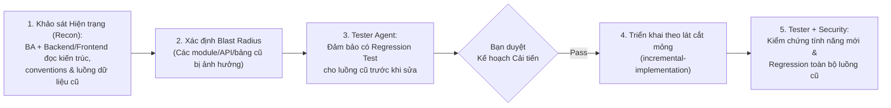

- **Nguyên tắc cốt lõi**: **Do No Harm (Không phá vỡ cái đang chạy)**. Luôn đọc kỹ conventions hiện có của dự án trước khi đề xuất giải pháp; ưu tiên mở rộng tương thích ngược thay vì đập đi viết lại theo ý thích của AI.

---

### WF-13: Chuẩn bị & Kiểm duyệt Phát hành (Release Readiness)
- **Khi nào sử dụng**: Trước khi đóng gói phiên bản để triển khai lên môi trường Staging/Production.
- **Input cần có**: Danh sách các tính năng/bug fix trong đợt phát hành, kết quả chạy Test Suite, báo cáo Security và các file Migration (nếu có).

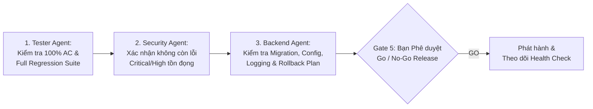

- **Checklist Xuất xưởng (`shipping-and-launch` + `definition-of-done.md`)**:
  - [ ] Toàn bộ Acceptance Criteria của các stories trong bản release đều đã được `tester-agent` xác minh Pass.
  - [ ] Không còn bug hay lỗ hổng bảo mật mức `Critical` hoặc `High` đang mở.
  - [ ] Nếu có Database Migration: Đã test kịch bản `Up` và `Down` an toàn, không khóa bảng lâu gây treo hệ thống.
  - [ ] Không còn biến môi trường, mật khẩu hay URL tạm thời bị hardcode trong code.
  - [ ] Đã có phương án Rollback rõ ràng trong trường hợp cần quay đầu khẩn cấp.

---

## Chương 5 — Hướng dẫn Phối hợp giữa các Agent

### 5.1. Giải đáp 10 Câu hỏi Điều hành Thực tế

1. **BA có phải tham gia mọi yêu cầu không?**
   - **Không.** Chỉ gọi `ba-agent` khi yêu cầu mới còn mơ hồ, có thay đổi quy tắc nghiệp vụ, phân quyền hoặc liên quan nhiều module. Nếu yêu cầu là sửa bug kỹ thuật đã rõ, refactor code, hoặc làm đúng theo một bản thiết kế/API đã có sẵn, hãy bỏ qua BA và gọi thẳng Developer Agent.
2. **Designer và Frontend bàn giao cho nhau như thế nào?**
   - Qua **1 trong 2 hình thức chuẩn**:
     - *Không dùng Figma*: `designer-agent` xuất file `DESIGN.md` ở gốc dự án $\to$ `frontend-agent` đọc `DESIGN.md` để lấy đúng bảng màu, font, spacing, variants và quy tắc responsive.
     - *Có dùng Figma*: `designer-agent` bàn giao link kèm **Node ID** cụ thể $\to$ `frontend-agent` kích hoạt `implement-design` để lấy ngữ cảnh thiết kế và chuyển thành code.
3. **Backend và Frontend thống nhất API Contract ra sao?**
   - **Trước khi tách ra code song song**, `backend-agent` phải xuất file đặc tả hợp đồng API (ví dụ `docs/contracts/<feature>-api.md` hoặc các file DTO/TypeScript interfaces) gồm: Endpoint URL, HTTP Method, Request Body/Query, Response JSON mẫu và các mã lỗi (`400`, `401`, `403`, `404`). Sau khi bạn duyệt (Gate 2), cả hai bên lấy file này làm chuẩn để làm việc độc lập.
4. **Khi nào Security review trước khi code, khi nào review sau?**
   - **Review TRƯỚC khi code (Shift-Left tại Gate 1/Gate 2)**: Khi tính năng liên quan đến Đăng nhập/Xác thực, Phân quyền theo phòng ban/chi nhánh, Phê duyệt đơn hàng/Thanh toán, Upload file hoặc gọi API ra bên ngoài.
   - **Review SAU khi code (tại Gate 3)**: Rà soát code/diff thực tế để bắt lỗi quên kiểm tra quyền trên bản ghi (IDOR/BOLA), Mass Assignment hoặc SQL Injection.
5. **Tester có thể bắt đầu viết test từ khi nào?**
   - **Ngay từ khi qua Gate 2 (khi đã có Spec AC và API Contract)**, `tester-agent` đã có thể thiết kế Test Plan, danh sách Test Cases (`TC-xx`) và khung kiểm thử mà không cần đợi Developer viết xong dòng code cuối cùng.
6. **Khi nào được chạy nhiều Agent song song?**
   - Chỉ chạy song song khi: **(1) Đã khóa chung một Hợp đồng (Spec / API Contract)** và **(2) Hai Agent làm việc trên các tập hợp file/thư mục hoàn toàn tách biệt** (ví dụ: `backend-agent` làm trong thư mục `/server` hoặc `/api`, còn `frontend-agent` làm trong thư mục `/client` hoặc `/web`).
7. **Khi nào cần dừng để chờ bạn xác nhận?**
   - Tại 4 thời điểm: (1) Còn câu hỏi nghiệp vụ/giả định `[Assumption]` chưa rõ; (2) Trước khi khóa API Contract hoặc thay đổi cấu trúc Database lớn; (3) Khi một Agent muốn thay đổi phạm vi (Scope) hoặc sửa đổi thành phần dùng chung của toàn dự án; (4) Trước khi đóng gói phát hành (Release).
8. **Nếu hai Agent đưa ra khuyến nghị mâu thuẫn, ai quyết định?**
   - Quy tắc ưu tiên chuyên môn:
     - Mâu thuẫn về **rủi ro bảo mật / phân quyền**: Ưu tiên đánh giá của `security-agent` (nhưng phải có bằng chứng khai thác thực tế).
     - Mâu thuẫn về **quy tắc nghiệp vụ**: Đối chiếu lại Spec của `ba-agent`.
     - Mâu thuẫn về **đánh đổi giữa Thẩm mỹ vs Hiệu năng/Độ phức tạp**: Trình bày ngắn gọn ưu/nhược điểm của cả 2 phương án để **Bạn (Project Owner)** chốt quyết định cuối cùng.
9. **Khi một Agent yêu cầu thêm thông tin, có nên gọi Agent khác ngay không?**
   - Nếu câu hỏi thuộc về **ý muốn của chủ dự án / quy tắc kinh doanh** $\to$ **Bạn trả lời trực tiếp**.
   - Nếu câu hỏi thuộc về **chi tiết kỹ thuật đã có trong hệ thống** (ví dụ: Frontend hỏi cấu trúc JSON trả về của một API) $\to$ Cho phép tra cứu trực tiếp trong codebase hoặc hỏi đúng `backend-agent` để lấy thông số thực tế.
10. **Làm thế nào tránh nhiều Agent cùng sửa một file hoặc cùng thay đổi một Contract?**
    - Áp dụng nghiêm ngặt **Quy tắc Quyền Sở hữu File (File Ownership Lock)** ở mục 5.2 dưới đây.

### 5.2. Quy tắc Phân định Ranh giới Sở hữu File (File Ownership Lock)

| Khu vực / Loại File | Agent duy nhất có quyền Ghi / Sửa | Các Agent khác chỉ được quyền Đọc (Read-Only) |
| :--- | :--- | :--- |
| `docs/specs/*.md`, `docs/sop/*.md` | `ba-agent` | `designer`, `backend`, `frontend`, `security`, `tester` |
| `DESIGN.md`, `design-system/*`, Figma Canvas | `designer-agent` | `frontend-agent`, `tester-agent` |
| `docs/contracts/*-api.md`, Backend Code, DB Migrations | `backend-agent` | `frontend-agent`, `tester-agent`, `security-agent` |
| Frontend Components, Pages, UI State, Styles | `frontend-agent` | `tester-agent`, `security-agent`, `designer-agent` |
| Test Suites (`tests/`, `*.spec.*`, `*.test.*`), Bug Reports | `tester-agent` *(Dev có thể viết Unit Test cho hàm của mình)* | `ba-agent`, `security-agent` |
| `docs/audits/*`, Security Findings Reports | `security-agent` | `backend-agent`, `frontend-agent`, `tester-agent` |

---

## Chương 6 — Artifact & Handover Contract (Hợp đồng Bàn giao & Templates)

Mọi hoạt động chuyển giao giữa các Agent phải thông qua các **Artifact chuẩn hóa**. Dưới đây là bảng quy định và mẫu (Template) có thể copy dùng ngay:

### 6.1. Bảng Quy chuẩn 10 Artifacts Bàn giao

| # | Tên Artifact | Ai tạo | Ai nhận | Khi nào bắt buộc | Khi nào được lược bỏ | Tiêu chí chấp nhận (Acceptance Bar) |
| :-: | :--- | :--- | :--- | :--- | :--- | :--- |
| **1** | **Idea / Problem Statement** | Bạn (hoặc `ba-agent` tóm tắt) | `ba-agent` | Khi khởi đầu tính năng mới. | Khi sửa bug hoặc task kỹ thuật đã rõ. | Nêu rõ bài toán cần giải quyết, đối tượng sử dụng và mục tiêu mong muốn. |
| **2** | **Lightweight / Full Spec** | `ba-agent` | Bạn duyệt $\to$ `designer`, `backend`, `frontend`, `tester` | Mọi tính năng mới hoặc thay đổi nghiệp vụ. | Bug fix thuần kỹ thuật, refactor nội bộ. | Đạt checklist DoR (Gate 1): Không còn `[Assumption]` mở, rõ RBAC & Out of Scope. |
| **3** | **Acceptance Criteria (BDD)** | `ba-agent` | `backend`, `frontend`, `tester` | Mọi yêu cầu có thay đổi hành vi hệ thống. | Chỉ viết tài liệu hoặc dọn dẹp code chết. | Viết theo `Given - When - Then`, đánh mã `AC-xx.y`, bao phủ cả Happy Path & Edge Cases. |
| **4** | **Design Handoff (`DESIGN.md` / Figma)** | `designer-agent` | `frontend-agent`, `tester-agent` | Khi làm sản phẩm/giao diện mới cần định hình UI/UX. | Task chỉ làm Backend hoặc dùng nguyên component cũ. | Có đủ Design Tokens, Component Variants, 5 UI States và quy tắc Responsive. |
| **5** | **API & DTO Contract** | `backend-agent` | `frontend-agent`, `tester-agent`, `security-agent` | Khi tạo mới hoặc sửa đổi bất kỳ API nào. | Task chỉ làm giao diện tĩnh hoặc sửa nội bộ 1 hàm. | Rõ Method, URL, Request/Response DTO, quy tắc phân quyền và mã lỗi HTTP. |
| **6** | **Implementation Summary** | `backend-agent` / `frontend-agent` | `security-agent`, `tester-agent`, Bạn | Sau khi hoàn thành viết hoặc sửa code. | Không được lược bỏ khi có thay đổi code. | Liệt kê danh sách file đã sửa, cách đáp ứng AC/Contract và lệnh chạy kiểm tra. |
| **7** | **Test Plan & Test Report** | `tester-agent` | Bạn, Developer Agents | Mọi tính năng mới, sửa bug hoặc refactor. | Khi chỉ viết tài liệu lý thuyết. | Có danh sách Test Cases ánh xạ với `AC-xx`, kết quả chạy thực tế (Pass/Fail) trên DB/UI thật. |
| **8** | **Bug Report** | `tester-agent` | `backend-agent` / `frontend-agent` / `security-agent` | Khi phát hiện lỗi thực tế trong quá trình test. | Khi toàn bộ test đều Pass 100%. | Đủ 5 mục: Tiêu đề + Severity, Môi trường, Steps to Reproduce, Actual vs Expected, Evidence/Root-Cause Hint. |
| **9** | **Security Findings Report** | `security-agent` | Bạn, `backend-agent`, `frontend-agent`, `tester-agent` | Khi thực hiện Security Review hoặc Audit. | Task UI tĩnh không chạm dữ liệu/input. | Phân loại rõ `confirmed` / `needs_validation`, mức độ rủi ro, vị trí dòng code, PoC an toàn và cách vá. |
| **10** | **Release Checklist** | `tester-agent` + `backend-agent` | Bạn (Phê duyệt phát hành) | Trước mỗi đợt deploy lên Production. | Các bản nháp thử nghiệm nội bộ trên máy cá nhân. | Xác nhận Pass toàn bộ AC, Regression, Security, Migration và có phương án Rollback. |

---

### 6.2. Bộ Mẫu (Templates) Chuẩn — Sẵn sàng Copy & Sử dụng

#### Mẫu 1: Feature Spec & Acceptance Criteria (`docs/specs/<feature>-spec.md`)
```markdown
# SPEC: [Tên Tính năng] — Mã: REQ-01
- **Phân loại**: [Lightweight Spec / Full Spec]
- **Trạng thái**: [Draft / Ready for Dev]

## 1. Context & Impact Analysis (Hiện trạng & Tác động)
- **Tài nguyên tái sử dụng**: [Liệt kê bảng DB, API, Component hiện có]
- **Tác động hồi quy (Regression Impact)**: [Các module/API cũ có thể bị ảnh hưởng]

## 2. Facts / Assumptions / Decisions
- **Facts (Đã xác nhận)**: ...
- **Assumptions (Cần chốt)**: `[Assumption-01]: ...`
- **Decisions (Quyết định nghiệp vụ)**: ...

## 3. Ma trận Phân quyền (RBAC & Data Scope)
| Vai trò (Role) | Quyền thao tác (Xem/Tạo/Sửa/Duyệt) | Phạm vi dữ liệu (Scope: Cá nhân / Phòng ban / Toàn công ty) |
| :--- | :--- | :--- |

## 4. User Stories & Acceptance Criteria (Gherkin BDD)
### US-01: As a [...], I want to [...], so that [...]
- **AC-01.1 (Happy Path)**:
  - `Given` [...]
  - `When` [...]
  - `Then` [...]
- **AC-01.2 (Edge Case / Từ chối quyền / Bấm đúp)**:
  - `Given` [...]
  - `When` [...]
  - `Then` [...]

## 5. Data Dictionary & Out of Scope
- **Trường dữ liệu**: `Tên trường | Kiểu | Bắt buộc | Quy tắc Validation`
- **Out of Scope (Không làm trong bản này)**: ...
```

#### Mẫu 2: API & DTO Contract (`docs/contracts/<feature>-api.md`)
````markdown
# API CONTRACT: [Tên Module/Tính năng]
- **Endpoint**: `[POST/GET/PUT/DELETE] /api/v1/[resource]`
- **Authentication & Authorization**: [Role yêu cầu + Kiểm tra quyền sở hữu tài nguyên/Site/Department]
- **Idempotency / Concurrency**: [Có dùng RowVersion / Idempotency-Key hay không?]

## Request Payload / Query Params
```json
{
  "fieldA": "string (required, max 100)",
  "amount": 150000
}
```

## Response 200/201 (Success)
```json
{
  "data": { "id": "uuid", "status": "Pending", "rowVersion": "0x000001" }
}
```

## Standard Error Responses (400 / 401 / 403 / 404 / 409 Conflict)
```json
{
  "errorCode": "ERR_FORBIDDEN_SCOPE",
  "message": "Bạn không có quyền thao tác trên đơn hàng thuộc chi nhánh khác.",
  "details": [],
  "timestamp": "2026-10-25T10:00:00Z"
}
```
````

#### Mẫu 3: Bug Report Chuẩn 5 Mục (Từ `tester-agent` gửi Developer)
```markdown
# BUG REPORT: [BUG-01] [Critical/High/Medium/Low] - [Tóm tắt lỗi ngắn gọn]
1. **Môi trường & Dữ liệu test**: Nhánh `...`, User thực hiện: `user_dept_A`, Bản ghi đích: `order_dept_B (ID: 105)`.
2. **Các bước tái hiện (Steps to Reproduce)**:
   - Bước 1: Đăng nhập bằng tài khoản `user_dept_A`.
   - Bước 2: Gửi request `GET /api/orders/105` (hoặc truy cập URL `/orders/105`).
3. **Actual vs Expected (Trích dẫn AC)**:
   - **Actual**: API trả về `200 OK` kèm toàn bộ thông tin đơn hàng của Phòng ban B.
   - **Expected (theo AC-01.2)**: API phải trả về `403 Forbidden` do khác phạm vi phòng ban.
4. **Dẫn chứng (Evidence)**: [Đính kèm Response JSON / Console Log / Screenshot].
5. **Gợi ý nguyên nhân gốc (Root-Cause Hint)**: Tại `OrderService.GetByIdAsync()`, câu truy vấn chỉ lọc theo `Id == orderId` mà thiếu điều kiện `.Where(x => x.DepartmentId == currentUser.DepartmentId)`.
```

---

## Chương 7 — Quản lý Skills Hiệu quả

### 7.1. Phân biệt Agent Role vs Skill Workflow
- **Agent Role (`.agent/rules/*.md`)**: Xác định **"Ai đang làm việc, tiêu chuẩn chất lượng là gì và ranh giới nào không được vượt qua"**.
- **Skill (`.agent/skills/*/SKILL.md`)**: Xác định **"Cách thực hiện từng bước cho một công việc cụ thể"**.
- **Lưu ý quan trọng**: Việc bạn nhắc tên một Skill trong câu lệnh (prompt) **không đồng nghĩa** với việc Agent đã thực thi đầy đủ các bước trong Skill đó. Agent bắt buộc phải mở file `SKILL.md` tương ứng ra đọc (`read_file`) và xuất ra đúng sản phẩm mà Skill đó yêu cầu.

### 7.2. Bảng Phân luồng Gọi Skill cho từng Agent (Default vs Conditional)

| Agent | Skill Mặc định (Gọi trong 80% tác vụ chính) | Skill Có Điều kiện (Chỉ gọi khi đúng ngữ cảnh) | Khi nào KHÔNG cần gọi thêm Skill |
| :--- | :--- | :--- | :--- |
| **`ba-agent`** | `spec-driven-development` | - `interview-me` *(khi yêu cầu quá sơ sài)*<br/>- `idea-refine` *(khi cần phản biện ý tưởng)*<br/>- `planning-and-task-breakdown` *(sau khi duyệt Spec)*<br/>- `context-engineering` *(trước khi giao Dev)*<br/>- `sop-generator` / `handover-report-generator` | Khi chỉ cập nhật 1-2 dòng AC nhỏ trong bản Spec đã có sẵn. |
| **`designer-agent`** | `ui-ux-pro-max` **hoặc** `design-taste-frontend` | - `figma-use` + `figma-generate-design` *(chỉ khi vẽ lên Figma MCP)*<br/>- `implement-design` *(khi đọc thông số từ Figma)* | Khi chỉ chỉnh sửa nhẹ 1 mã màu hoặc thêm 1 biến thể nhỏ vào file `DESIGN.md` đã có. |
| **`frontend-agent`** | `frontend-ui-engineering` | - `implement-design` + `figma-use` *(khi chuyển từ Figma sang Code)*<br/>- `design-taste-frontend` *(khi làm mới thẩm mỹ trang quan trọng)*<br/>- `browser-testing-with-devtools` *(khi debug trên trình duyệt)*<br/>- `performance-optimization` *(khi tối ưu Web Vitals)* | Khi chỉ sửa lỗi chính tả, đổi nhãn nút hoặc sửa 1 dòng điều kiện hiển thị đơn giản. |
| **`backend-agent`** | `api-and-interface-design` + `incremental-implementation` | - `deprecation-and-migration` *(khi sửa DB schema/migration)*<br/>- `performance-optimization` *(khi xử lý N+1 / query chậm)*<br/>- `observability-and-instrumentation` *(khi thêm log/metrics)*<br/>- `source-driven-development` *(khi tra cứu API thư viện mới)* | Khi sửa 1 bug logic nhỏ đã biết rõ dòng code (`WF-04`). |
| **`security-agent`** | `security-and-hardening` + `code-review-and-quality` | - `security-audit` *(chỉ khi yêu cầu Full Audit 6 giai đoạn / Pen-test)*<br/>- `doubt-driven-development` *(khi phản biện quyết định rủi ro cao)* | Không gọi `security-audit` (6 bước nặng nề) cho một PR nhỏ chỉ sửa vài dòng code. |
| **`tester-agent`** | `test-driven-development` | - `browser-testing-with-devtools` *(khi test UI/E2E)*<br/>- `debugging-and-error-recovery` *(khi điều tra bug `WF-05`)*<br/>- `constraint-driven-development` *(khi thiết lập `CONSTRAINTS.md`)*<br/>- `shipping-and-launch` *(khi kiểm duyệt Release `WF-13`)* | Khi chỉ viết lại báo cáo Bug Report từ kết quả log đã có sẵn. |

### 7.3. Quy tắc Xử lý các Cặp Skill có Chức năng Giao thoa (Chống Trùng lặp)

1. **`design-taste-frontend` (`taste-skill`) vs `frontend-design` vs `ui-ux-pro-max`**:
   - **Không bao giờ nạp cả 3 cùng lúc**.
   - Cần tra cứu dữ liệu ngành hàng, bảng màu, font, biểu đồ hoặc tạo `MASTER.md` $\to$ Dùng `ui-ux-pro-max`.
   - Cần định hướng nghệ thuật cao cấp, bố cục độc bản (anti-slop) cho Landing Page / Dashboard lớn $\to$ Dùng `design-taste-frontend`.
   - Cần hướng dẫn nhanh gọn cho 1 component/màn hình nhỏ $\to$ Dùng `frontend-design`.
2. **`implement-design` vs `figma-design-to-code`**:
   - Hai thư mục này trong workspace có **cùng nội dung 100%** (bản alias để tương thích tên gọi). Chỉ gọi **1 trong 2** (`implement-design`).
3. **`security-and-hardening` vs `security-audit` vs `code-review-and-quality`**:
   - Review PR/Diff hàng ngày $\to$ Dùng `code-review-and-quality` + `security-and-hardening`.
   - Tổng kiểm tra bảo mật định kỳ toàn bộ dự án và xuất báo cáo `findings.json` / `REPORT.md` $\to$ Dùng `security-audit`.
4. **Cách xử lý khi Skill gặp lỗi phụ thuộc (Dependency Missing)**:
   - Nếu gọi `figma-use` / `implement-design` nhưng chưa kết nối Figma MCP $\to$ Chuyển ngay sang **Chế độ A (`DESIGN.md`)** của `designer-agent`.
   - Nếu gọi `ui-ux-pro-max` nhưng máy chưa cài Python để chạy `search.py` $\to$ Yêu cầu Agent đọc trực tiếp file `references/quick-reference.md` và `references/pro-rules.md` nằm sẵn trong thư mục `.agent/skills/ui-ux-pro-max/`.

---

## Chương 8 — Quality Gates & Quyền Quyết định (Gate 0 – Gate 5)

Áp dụng mô hình **Kiểm soát Tương xứng với Rủi ro (Risk-Proportional Governance)**:
- **Tính năng lớn / Liên quan tiền bạc, phân quyền, DB**: Đi qua đầy đủ Gate 0 $\to$ Gate 5.
- **Task nhỏ / Bug fix đơn giản**: Gộp nhanh Gate 0 + Gate 3 + Gate 4.

| Cổng (Gate) | Câu hỏi cốt lõi | Điều kiện PASS (Tiêu chí vượt cổng) | Điều kiện FAIL (Chặn lại ngay) | Ai xác minh | Ai phê duyệt | Ngoại lệ cho phép & Cách ghi nhận rủi ro |
| :--- | :--- | :--- | :--- | :--- | :--- | :--- |
| **Gate 0: Problem & Scope Gate** | *Yêu cầu đã đủ rõ để bắt đầu chưa?* | Xác định rõ mục tiêu, đối tượng dùng, luồng chính và phạm vi thay đổi; đã chọn đúng Workflow (`WF-01`..`WF-13`). | Yêu cầu chỉ có 1 câu mơ hồ hoặc mâu thuẫn với hệ thống hiện tại. | `ba-agent` *(hoặc Dev nếu task nhỏ)* | **Bạn** | Bug rõ ràng có stack trace (`WF-04`) được đi thẳng vào Gate 3. |
| **Gate 1: Spec & DoR Gate** | *Đặc tả & AC đã sẵn sàng cho Dev chưa?* | Có đủ mã `REQ` $\to$ `US` $\to$ `AC` (Given-When-Then); rõ ma trận RBAC; đã phân tích Regression Impact; **0 mục `[Assumption]` trọng yếu còn bỏ ngỏ**. | Còn câu hỏi nghiệp vụ mở hoặc thiếu kịch bản xử lý ngoại lệ/phân quyền. | `ba-agent` | **Bạn** | Với `Lightweight Spec`, chỉ cần mô tả Expected Behavior + AC ngắn gọn. |
| **Gate 2: Design & Contract Gate** | *Giao diện, API & DB Schema đã khớp nhau chưa?* | Đã có `DESIGN.md` (hoặc Figma Node) và `API Contract` (DTO, URL, Error codes, Auth scope); Frontend và Backend đã thống nhất tên trường 100%. | Chưa có cấu trúc JSON/DTO thống nhất hoặc thiết kế UI đòi hỏi dữ liệu mà DB/API không có. | `backend-agent` + `frontend-agent` + `designer-agent` | **Bạn** *(nếu đổi DB hoặc API lớn)* | Bỏ qua nếu task chỉ làm thuần UI tĩnh hoặc chỉ sửa nội bộ 1 phía không đổi Contract. |
| **Gate 3: Implementation & Security Gate** | *Code đã chạy đúng phạm vi và an toàn chưa?* | Code biên dịch không lỗi; tuân thủ chuẩn dự án; kiểm tra đủ Resource/Scope Authorization (chống IDOR); không vi phạm File Ownership Lock. | Code lỗi build, lộ thông tin nhạy cảm, thiếu kiểm tra quyền ở server, hoặc tự ý sửa file dùng chung ngoài phạm vi. | `backend` / `frontend` + `security-agent` | Lead Agent / **Bạn** | Các góp ý mức `Low` / `Hardening Note` có thể ghi vào backlog kỹ thuật để làm sau. |
| **Gate 4: QA & Regression Gate** | *Bằng chứng kiểm thử đã đạt 100% chưa?* | Toàn bộ `AC-xx` đều có test pass; Integration Test chạy trên DB thật pass; Regression Suite liên quan pass; không có lỗi Console/Network 500. | Bất kỳ AC nào fail, phát hiện bug `Critical/High`, hoặc Agent dùng `test.skip` để làm xanh test giả tạo. | `tester-agent` | `tester-agent` đề xuất $\to$ **Bạn** duyệt | Nếu có bug mức `Low` không ảnh hưởng nghiệp vụ chính, bạn có thể ký duyệt `Accepted Risk` kèm ticket sửa ở bản kế tiếp. |
| **Gate 5: Release Readiness Gate** | *Đủ điều kiện an toàn để lên Production chưa?* | Đạt Gate 4; Migration `Up/Down` đã test an toàn; có đầy đủ Logging/Correlation ID; đã sẵn sàng phương án Rollback trong 5 phút. | Chưa test Migration trên dữ liệu mẫu, còn lỗ hổng bảo mật `High/Critical` hoặc không có đường lùi (Rollback). | `tester-agent` + `backend-agent` + `security-agent` | **Bạn (Quyền tối cao)** | Trong sự cố khẩn cấp (`WF-10`), cho phép rút gọn thủ tục tài liệu nhưng bắt buộc giữ Smoke Test + Rollback Plan. |

---

## Chương 9 — Quy trình Xử lý Tình huống Ngoại lệ (13 Kịch bản)

Bảng cẩm nang phản ứng nhanh khi quá trình vận hành gặp sự cố hoặc lệch chuẩn:

| # | Tình huống Ngoại lệ | Dấu hiệu nhận biết | Hành động của Bạn (Orchestrator) | Agent cần gọi | Quyết định tiếp theo | Điều kiện để tiếp tục |
| :-: | :--- | :--- | :--- | :--- | :--- | :--- |
| **1** | **Thiếu thông tin nghiệp vụ** | Agent tự bịa quy tắc tính tiền/phân quyền hoặc để trống chi tiết trong Spec/Code. | Yêu cầu dừng viết code ngay; buộc liệt kê các điểm chưa rõ thành danh sách câu hỏi đánh số. | `ba-agent` (kích hoạt `interview-me`) | Bạn trực tiếp chốt câu trả lời cho từng câu hỏi. | Mọi mục `[Assumption]` đã chuyển thành `[Fact]` hoặc `[Decision]`. |
| **2** | **Yêu cầu đầu vào mâu thuẫn** | Quy tắc mới xung đột trực tiếp với logic cũ hoặc hai yêu cầu trong cùng 1 bài toán đá nhau. | Không cho phép Agent tự chọn bừa 1 trong 2; yêu cầu đặt lên bàn cân so sánh tác động. | `ba-agent` + `backend-agent` | Bạn chọn phương án chính thức và cập nhật lại Spec. | Spec không còn điều khoản mâu thuẫn. |
| **3** | **Agent trả kết quả sai định dạng** | Yêu cầu xuất Bug Report 5 mục hoặc Spec chuẩn nhưng Agent chỉ viết đoạn văn xuôi lan man. | Từ chối nghiệm thu; dán thẳng **Template mẫu ở Chương 6** vào prompt và yêu cầu xuất lại. | Chính Agent vừa làm sai | Kiểm tra lại đầu ra so với Template. | File xuất ra khớp 100% cấu trúc Template bắt buộc. |
| **4** | **Agent đề xuất hoặc tự ý sửa vượt phạm vi (Scope Creep)** | Đang giao sửa 1 màn hình nhưng Agent tiện tay sửa luôn `tailwind.config`, `Button.tsx` dùng chung hoặc refactor 10 file khác. | Yêu cầu `git checkout` / hoàn tác các file ngoài phạm vi ngay lập tức. | Agent vừa thực hiện | Nhắc lại Guardrail **File Ownership Lock** và giới hạn đúng danh sách file được phép chạm vào. | Diff chỉ chứa đúng các file thuộc phạm vi task đã giao. |
| **5** | **Test thất bại nhưng không tái hiện được ổn định (Flaky Test)** | Chạy lần 1 Fail, chạy lần 2 Pass, hoặc chạy đơn lẻ thì Pass nhưng chạy cả bộ thì Fail. | Cấm bỏ qua (`test.skip`) và cấm đổ lỗi vội cho code sản phẩm; yêu cầu điều tra tính cô lập của test. | `tester-agent` | Kiểm tra xem có dùng chung dữ liệu tĩnh, thiếu `await` hoặc rò rỉ state giữa các test không. | Test chạy liên tiếp 3–5 lần đều cho kết quả nhất quán (Deterministic). |
| **6** | **Hai Agent đưa ra kết luận trái ngược nhau** | Ví dụ: `backend-agent` bảo lỗi do UI gửi sai, `frontend-agent` bảo do API trả về chậm/sai; hoặc Dev và Security bất đồng về mức độ lỗi. | Yêu cầu cả hai dừng tranh luận lý thuyết; buộc đưa ra **bằng chứng log/payload thực tế** tại ranh giới giao tiếp. | `tester-agent` hoặc `security-agent` *(đóng vai trò trọng tài độc lập)* | Bạn dựa trên bằng chứng thực tế và Ma trận ưu tiên (Mục 5.1) để phán quyết. | Xác định rõ 1 nguyên nhân gốc duy nhất có bằng chứng chứng minh. |
| **7** | **Một Agent bị lặp vòng hoặc không hoàn thành được nhiệm vụ** | Agent sửa đi sửa lại quá 2–3 lượt mà lỗi vẫn còn hoặc ngữ cảnh phiên chat quá dài làm Agent bị rối. | Dừng phiên làm việc hiện tại; kích hoạt `context-engineering` hoặc `handover-report-generator` để tóm tắt trạng thái. | Mở phiên mới (Fresh Context) với cùng Agent hoặc dùng `debugging-and-error-recovery` | Cung cấp lại gói ngữ cảnh tinh gọn (chỉ gồm lỗi hiện tại + file liên quan). | Agent mới xác định được hướng tiếp cận rõ ràng không lặp lại cách cũ đã hỏng. |
| **8** | **Skill bị thiếu, lỗi đường dẫn hoặc không phù hợp với Stack** | Agent báo không tìm thấy script (như thiếu Python cho `ui-ux-pro-max` hoặc chưa bật Figma MCP). | Chỉ thị dùng cơ chế **Fallback (Dự phòng)** đã quy định ở Mục 7.3 (đọc file markdown tham chiếu trực tiếp hoặc xuất `DESIGN.md`). | Agent đang thực thi | Không dừng dự án vì thiếu công cụ phụ trợ nếu có thể làm qua file Markdown chuẩn. | Agent chuyển sang quy trình dự phòng và tạo ra Artifact tương đương. |
| **9** | **API Contract thay đổi sau khi Frontend đã code xong** | Trong lúc làm, Backend phát hiện cần đổi cấu trúc JSON hoặc thêm trường bắt buộc mà Frontend đã ghép xong mẫu cũ. | Kích hoạt quy trình `WF-11` thu nhỏ: Yêu cầu `backend-agent` liệt kê chính xác **Diff của API Contract** (trường nào đổi, trường nào thêm). | `backend-agent` $\to$ `frontend-agent` $\to$ `tester-agent` | Bạn duyệt thay đổi Contract trước, sau đó giao đúng phần diff đó cho Frontend cập nhật. | File `api-contract.md`, code Backend, code Frontend và Test đều đồng bộ theo phiên bản mới. |
| **10** | **Database Migration thất bại hoặc gây lỗi dữ liệu** | Lệnh chạy migration báo lỗi Foreign Key, Unique Constraint hoặc làm mất dữ liệu trên môi trường Test/Staging. | Dừng ngay lập tức việc đẩy lên môi trường cao hơn; thực thi kịch bản `Down` / khôi phục bản backup trên Test DB. | `backend-agent` (kích hoạt `deprecation-and-migration`) | Phân tích dữ liệu thực tế đang gây xung đột (ví dụ dữ liệu cũ bị trùng hoặc `NULL`), viết script làm sạch dữ liệu trước khi gắn constraint. | Chạy lại `Up -> Down -> Up` trên Test DB có chứa dữ liệu bản sao thực tế thành công 100%. |
| **11** | **Phát hiện lỗ hổng bảo mật nghiêm trọng (`Critical` / `High`)** | `security-agent` chứng minh được lỗi IDOR xem trộm dữ liệu phòng ban khác, lộ khoá bí mật hoặc SQL Injection (`confirmed`). | **Chặn cổng phát hành (Block Gate 3 / Gate 5)** ngay lập tức. Nếu lỗ hổng đang nằm trên Production, kích hoạt `WF-10` (Hotfix). | `security-agent` + `backend-agent` + `tester-agent` | Ưu tiên số 1 cho việc vá lỗ hổng và thu hồi (rotate) secret nếu bị lộ. | `security-agent` xác nhận bản vá đã chặn đứng PoC và `tester-agent` đã thêm Security Regression Test. |
| **12** | **Deadline gấp nhưng chưa kịp viết đủ toàn bộ Test tự động** | Cần phát hành gấp theo yêu cầu kinh doanh nhưng chỉ mới có thời gian viết test cho các luồng chính. | Không bỏ qua kiểm thử hoàn toàn; yêu cầu áp dụng **Risk-Based Testing tối thiểu**. | `tester-agent` | Chỉ bắt buộc chạy test cho **Luồng Happy Path chính + Kiểm tra Phân quyền/Tiền bạc**. Các edge cases phụ đưa vào danh sách nợ kỹ thuật. | Bạn ký duyệt `Accepted Risk` tại Gate 5 và tạo ngay Task bổ sung test sau khi lên golive. |
| **13** | **Agent tuyên bố "Đã hoàn thành" nhưng không đưa ra bằng chứng** | Agent chỉ trả lời *"Tôi đã sửa xong lỗi và mọi thứ hoạt động tốt"* mà không có kết quả chạy test, không có log hay danh sách dòng code. | **Bác bỏ trạng thái Done**; giữ trạng thái task ở `In Review`. | Chính Agent đó + `tester-agent` | Yêu cầu chạy lệnh kiểm tra thực tế và dán kết quả đầu ra (terminal output / test report). | Có bằng chứng xác thực (Test Pass log, Build log, ảnh chụp hoặc diff rõ ràng). |

---

## Chương 10 — Ví dụ Thực tế End-to-End (5 Kịch bản Doanh nghiệp)

> **Lưu ý**: 5 ví dụ dưới đây minh họa cách áp dụng các Agent và Skill **đã được xác minh có thật trong `d:\AI AGENT`** vào bối cảnh dự án doanh nghiệp thực tế (như hệ thống Intranet Portal & Purchasing).

---

### Ví dụ A — Từ Ý tưởng đến Chức năng Mới Hoàn chỉnh
- **Yêu cầu đầu vào**: *"Tôi muốn thêm tính năng Yêu cầu mua hàng (Purchase Request - PR) và luồng Phê duyệt theo phòng ban."*
- **Workflow được chọn**: **WF-01 (Full Feature Delivery)** — Vì đây là tính năng mới hoàn toàn, có quy trình trạng thái, phân quyền phòng ban và cả giao diện lẫn cơ sở dữ liệu.
- **Những Agent/Skill KHÔNG cần gọi & Lý do**: Không gọi `figma-use` / `figma-generate-design` nếu dự án dùng trực tiếp file `DESIGN.md` và thư viện UI có sẵn trong code; không gọi `security-audit` (6 pha nặng nề) từ đầu mà chỉ dùng `security-and-hardening` để thiết kế phân quyền và review code.

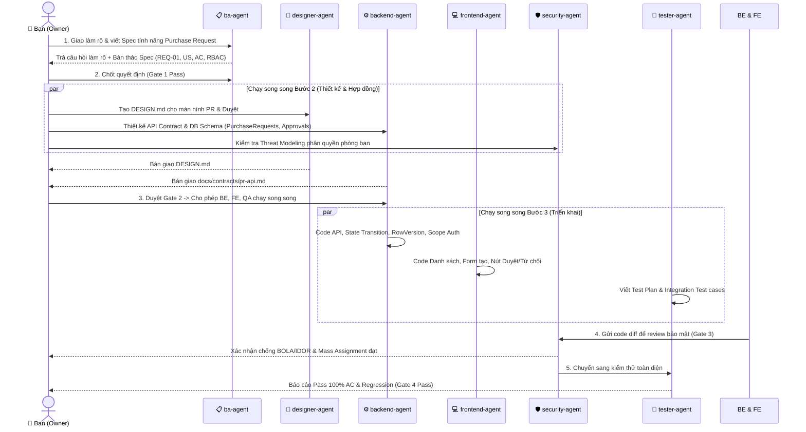

- **Thứ tự gọi Agent/Skill & Prompt mẫu có thể copy ngay**:
  - **Lượt 1 (Gọi `ba-agent` + `spec-driven-development`)**:
    ```text
    Áp dụng quy tắc trong .agent/rules/ba-agent.md và kích hoạt skill spec-driven-development:
    Hãy phân tích yêu cầu "Thêm tính năng Yêu cầu mua hàng (Purchase Request) và Phê duyệt theo phòng ban".
    1. Thực hiện Context & Impact Analysis.
    2. Liệt kê rõ Facts / Assumptions / Decisions.
    3. Thiết lập ma trận RBAC & Data Scope (Nhân viên tạo, Trưởng phòng duyệt trong phạm vi phòng ban của mình).
    4. Viết User Stories và Acceptance Criteria (Gherkin BDD) cho luồng: Tạo nháp -> Gửi duyệt -> Phê duyệt / Từ chối -> Hủy.
    Xuất ra file docs/specs/purchase-request-spec.md và dừng lại chờ tôi duyệt Gate 1.
    ```
  - **Lượt 2 (Sau khi bạn duyệt Spec — Gọi `backend-agent` + `api-and-interface-design`)**:
    ```text
    Áp dụng .agent/rules/backend-agent.md và skill api-and-interface-design:
    Dựa trên file docs/specs/purchase-request-spec.md đã duyệt, hãy thiết kế:
    1. Cấu trúc bảng DB (chú ý cột DepartmentId và RowVersion chống duyệt trùng).
    2. Hợp đồng API & DTO Contract tại docs/contracts/purchase-request-api.md để Frontend và Tester làm việc song song.
    Dừng lại chờ tôi duyệt Gate 2 trước khi viết code xử lý.
    ```
- **Artifact bàn giao giữa các bước**: `docs/specs/purchase-request-spec.md` $\to$ `DESIGN.md` & `docs/contracts/purchase-request-api.md` $\to$ Source Code $\to$ Test Report.
- **Quyết định bạn cần đưa ra**: Chốt hạn mức tiền cần cấp cao hơn duyệt (tại Gate 1) và duyệt cấu trúc bảng DB (tại Gate 2).
- **Điều kiện Pass/Fail**: **Pass** khi Nhân viên tạo được PR, Trưởng phòng cùng phòng ban duyệt thành công, Trưởng phòng ban khác bị chặn `403 Forbidden`, và bấm đúp nút duyệt không tạo ra 2 bản ghi lịch sử phê duyệt.

---

### Ví dụ B — Chỉ Cần Thêm Một Màn hình (API Đã Tồn tại)
- **Yêu cầu đầu vào**: *"Thêm màn hình danh sách Nhà cung cấp (Vendors) kèm bộ lọc tìm kiếm và modal tạo mới. Các API `GET /api/vendors` và `POST /api/vendors` đã có sẵn và hoạt động ổn định."*
- **Workflow được chọn**: **WF-02 (UI-Only Delivery)** — Vì không có bất kỳ thay đổi nào ở tầng Backend hay Database.
- **Những Agent/Skill KHÔNG cần gọi & Lý do**:
  - **Bỏ qua `ba-agent`**: Nghiệp vụ và API đã rõ ràng 100%.
  - **Bỏ qua `backend-agent`**: API đã tồn tại.
  - **Bỏ qua `designer-agent`**: Nếu dự án Intranet đã có sẵn hệ thống bảng biểu/modal chuẩn hoặc file `DESIGN.md`, gọi thẳng `frontend-agent`.

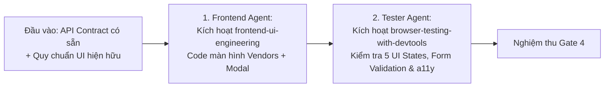

- **Prompt mẫu giao việc cho `frontend-agent`**:
  ```text
  Áp dụng .agent/rules/frontend-agent.md và skill frontend-ui-engineering:
  Hãy xây dựng màn hình Quản lý Nhà cung cấp (Vendors) tích hợp với 2 API hiện có: GET /api/vendors và POST /api/vendors.
  Yêu cầu:
  1. Khảo sát và tái sử dụng các component Table, Modal, Button, Input hiện có trong dự án (Context First).
  2. Xử lý đầy đủ các trạng thái cho danh sách: Loading (Skeleton), Empty State (kèm nút "Thêm nhà cung cấp"), Error State (theo mã HTTP 401/403/500) và Success.
  3. Trong Modal tạo mới: Kiểm tra validation trước khi gửi, vô hiệu hóa nút Submit khi đang gọi API (chống bấm đúp).
  4. Không sửa đổi các component dùng chung hoặc file cấu hình theme toàn cục.
  ```
- **Điều kiện Pass/Fail**: **Pass** khi danh sách tải đúng dữ liệu, tạo mới thành công, hiển thị đúng Skeleton khi mạng chậm, báo lỗi inline khi bỏ trống trường bắt buộc và điều hướng được bằng bàn phím (`Tab`, `Escape` đóng modal).

---

### Ví dụ C — Tester Phát hiện Lỗi Phân quyền Nghiêm trọng (IDOR / BOLA)
- **Yêu cầu đầu vào**: Trong lúc kiểm thử, `tester-agent` phát hiện: *"Người dùng thuộc Phòng ban A (`deptId = 10`) khi đổi ID trên URL `/api/purchase-requests/99` vẫn xem được toàn bộ chi tiết đơn mua hàng số `99` thuộc Phòng ban B (`deptId = 20`)."*
- **Workflow được chọn**: **WF-06 (Tester Bug Triage Loop)** kết hợp **security-agent**.
- **Những Agent/Skill KHÔNG cần gọi**: Không cần gọi `ba-agent` hay `designer-agent` vì quy tắc đã ghi rõ trong Spec là chỉ được xem đơn trong phạm vi phòng ban của mình.

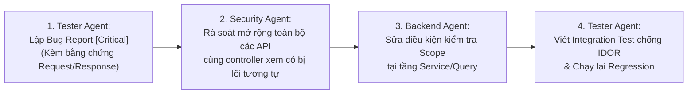

- **Thứ tự phối hợp & Prompt mẫu**:
  1. **`tester-agent` xuất Bug Report** theo đúng Mẫu 3 ở Chương 6, gắn nhãn `[Critical] - Broken Object/Scope Level Authorization`.
  2. **Gọi `security-agent` + `backend-agent` xử lý triệt để**:
     ```text
     Áp dụng .agent/rules/security-agent.md và .agent/rules/backend-agent.md:
     Dựa trên [BUG-01] do Tester báo cáo (User phòng ban A xem được đơn hàng phòng ban B qua GET /api/purchase-requests/{id}):
     1. Security Agent: Rà soát toàn bộ các endpoints liên quan (GET by ID, PUT, DELETE, Approve, Export) trong module PurchaseRequest xem còn chỗ nào thiếu kiểm tra DepartmentId / Scope không.
     2. Backend Agent: Khắc phục triệt để việc kiểm tra quyền theo phạm vi phòng ban ở tầng Server và trả về 403 Forbidden khi truy cập trái phép.
     ```
  3. **`tester-agent` xác minh**: Viết bài Integration Test tự động đăng nhập User Phòng ban A gọi vào toàn bộ các API đọc/sửa/xóa/duyệt đơn của Phòng ban B, đảm bảo 100% trả về `403 Forbidden`.

---

### Ví dụ D — Hai Request Phê duyệt Gửi Cùng Một Lúc (Concurrency & Race Condition)
- **Yêu cầu đầu vào**: *"Khi hai Phó Giám đốc cùng mở một đơn mua hàng đang ở trạng thái `Pending` và cùng bấm nút `Phê duyệt` tại cùng một thời điểm (hoặc 1 người bấm đúp cực nhanh), hệ thống bị tạo ra 2 phiếu xuất kho và trừ ngân sách 2 lần."*
- **Workflow được chọn**: **WF-04 / WF-03** (Tập trung xử lý Concurrency Control & Idempotency giữa `backend-agent` và `tester-agent`).
- **Những Agent/Skill KHÔNG cần gọi**: Không cần `designer-agent`; `frontend-agent` chỉ cần disable nút bấm sau lần click đầu tiên, nhưng **trách nhiệm chặn cốt lõi bắt buộc thuộc về `backend-agent`**.

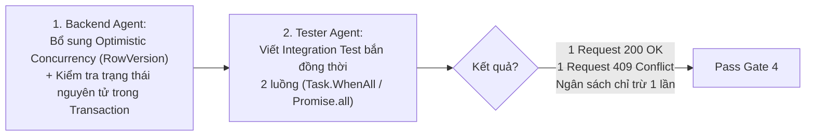

- **Prompt mẫu giao việc cho `backend-agent` & `tester-agent`**:
  ```text
  Áp dụng .agent/rules/backend-agent.md:
  Hãy khắc phục lỗi Race Condition khi phê duyệt đơn mua hàng tại endpoint POST /api/purchase-requests/{id}/approve:
  1. Áp dụng Concurrency Control (RowVersion / ConcurrencyToken hoặc khóa cập nhật có điều kiện WHERE Id = @id AND Status = 'Pending').
  2. Đảm bảo toàn bộ thao tác chuyển trạng thái, ghi lịch sử duyệt và trừ ngân sách nằm trong cùng một Transaction nguyên tử.
  3. Nếu request thứ 2 đến sau khi trạng thái đã chuyển, trả về mã lỗi 409 Conflict (Standard Error Envelope) và không thực hiện trừ ngân sách lần 2.
  Sau khi sửa xong, bàn giao cho tester-agent viết Integration Test chạy 2 request đồng thời trên Test Database thật để chứng minh.
  ```

---

### Ví dụ E — Thay đổi Yêu cầu Giữa Lúc Đang Triển khai (Mid-Flight Change Request)
- **Yêu cầu đầu vào**: Khi `backend-agent` và `frontend-agent` đã code xong 80% tính năng phê duyệt 1 cấp (Trưởng phòng duyệt là xong), Bạn đưa ra yêu cầu mới: *"Nếu tổng giá trị đơn hàng từ 50 triệu VNĐ trở lên, sau khi Trưởng phòng duyệt thì phải chuyển sang trạng thái `Waiting_Director` để Giám đốc duyệt thêm 1 bước nữa."*
- **Workflow được chọn**: **WF-11 (Mid-Flight Change Request)**.

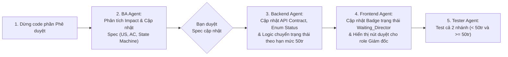

- **Prompt mẫu điều phối `WF-11`**:
  ```text
  Áp dụng quy trình WF-11 (Change Request) với .agent/rules/ba-agent.md:
  Yêu cầu thay đổi: "Đơn mua hàng >= 50.000.000 VNĐ cần qua 2 cấp phê duyệt: Trưởng phòng -> Giám đốc (trạng thái mới: Waiting_Director). Đơn < 50.000.000 VNĐ giữ nguyên 1 cấp Trưởng phòng."
  Hãy:
  1. Thực hiện Change Impact Analysis: Chỉ rõ những phần nào trong docs/specs/purchase-request-spec.md, API Contract, Database, UI và Test Cases bị ảnh hưởng.
  2. Cập nhật lại sơ đồ chuyển đổi trạng thái (Mermaid State Diagram) và bổ sung các AC mới cho mốc biên 49.999.999đ, 50.000.000đ và 50.000.001đ.
  Dừng lại chờ tôi xác nhận trước khi chuyển cho Backend và Frontend sửa code.
  ```

---

## Chương 11 — Prompt Library dành cho Người Điều phối

Bộ **13 Prompt Mẫu Thực dụng** dưới đây được thiết kế để bạn copy-paste trực tiếp vào khung chat khi điều hành dự án. Chỉ cần thay thế phần trong ngoặc vuông `[...]`:

### 11.1. Phân tích Yêu cầu Mới & Chọn Workflow (Orchestrator Triage)
```text
Tôi có yêu cầu sau: "[MÔ TẢ YÊU CẦU]".
Dựa vào AI_AGENT_OPERATING_PLAYBOOK.md (Chương 3 - Decision Matrix):
1. Hãy xác định đây thuộc loại yêu cầu nào và nên chạy theo Workflow nào (WF-01 đến WF-13)?
2. Liệt kê đúng những Agent và Skill cần gọi theo thứ tự, và những Agent nào KHÔNG cần gọi (kèm lý do).
3. Chưa thực thi vội, hãy trình bày kế hoạch điều phối ngắn gọn trong 10 dòng để tôi phê duyệt.
```

### 11.2. Yêu cầu BA Làm rõ Nghiệp vụ & Viết Spec (`ba-agent`)
```text
Đóng vai trò BA Agent (.agent/rules/ba-agent.md) và kích hoạt skill [interview-me / spec-driven-development]:
- Mục tiêu: Làm rõ và lập đặc tả cho yêu cầu "[MÔ TẢ YÊU CẦU]".
- Đầu vào: Khảo sát các file hiện có tại [ĐƯỜNG DẪN THƯ MỤC/FILE LIÊN QUAN].
- Đầu ra bắt buộc: Xuất file đặc tả tại [docs/specs/ten-file-spec.md] tuân thủ đúng cấu trúc: Context & Regression Impact, Facts/Assumptions/Decisions, RBAC Matrix, User Stories & Gherkin AC (REQ -> US -> AC), và Out of Scope.
- Giới hạn (Guardrail): Chỉ thực hiện đúng giai đoạn đặc tả, không viết code thực thi, không tự ý nhảy sang bước tiếp theo khi tôi chưa duyệt Gate 1.
```

### 11.3. Yêu cầu Designer Thiết kế UI hoặc Xuất `DESIGN.md` (`designer-agent`)
```text
Đóng vai trò Designer Agent (.agent/rules/designer-agent.md) và kích hoạt skill [ui-ux-pro-max / design-taste-frontend]:
- Mục tiêu: Thiết kế hệ thống giao diện cho tính năng "[TÊN TÍNH NĂNG]".
- Đầu vào: Đọc kỹ yêu cầu nghiệp vụ và 5 trạng thái UI tại [docs/specs/ten-file-spec.md].
- Đầu ra bắt buộc: Tạo/cập nhật file [DESIGN.md] (hoặc Figma Frame nếu được chỉ định) gồm: Art Direction, Design Tokens, Component Specs & Variants, Responsive Rules và cách hiển thị 5 UI States.
- Giới hạn: Bám sát luồng nghiệp vụ trong Spec, không tự ý thêm/bớt trường dữ liệu và không phá vỡ các token dùng chung đang có của dự án.
```

### 11.4. Yêu cầu Backend Thiết kế Contract & Triển khai API (`backend-agent`)
```text
Đóng vai trò Backend Agent (.agent/rules/backend-agent.md) và kích hoạt skill [api-and-interface-design / incremental-implementation]:
- Mục tiêu: Thiết kế và triển khai Backend cho "[TÊN TÍNH NĂNG]".
- Đầu vào: Đọc Spec tại [docs/specs/ten-file-spec.md] và khảo sát kiến trúc codebase hiện tại.
- Đầu ra bắt buộc:
  1. Xuất/cập nhật hợp đồng API & DTO tại [docs/contracts/ten-api.md].
  2. Triển khai code tuân thủ kiến trúc hiện hữu, đảm bảo Resource/Scope-Based Authorization (chống IDOR), Concurrency/Idempotency, và Safe Pagination.
- Giới hạn: Chỉ sửa đổi các file thuộc tầng Backend/DB; không lộ Entity trực tiếp ra API; báo cáo lại danh sách file đã sửa và kết quả build.
```

### 11.5. Yêu cầu Frontend Triển khai Giao diện theo Spec & Design (`frontend-agent`)
```text
Đóng vai trò Frontend Agent (.agent/rules/frontend-agent.md) và kích hoạt skill [frontend-ui-engineering / implement-design]:
- Mục tiêu: Xây dựng giao diện cho "[TÊN MÀN HÌNH / TÍNH NĂNG]".
- Đầu vào: Đọc Spec tại [docs/specs/ten-file-spec.md], thông số thiết kế tại [DESIGN.md / LINK FIGMA] và hợp đồng dữ liệu tại [docs/contracts/ten-api.md].
- Đầu ra bắt buộc: Code UI hoàn chỉnh, tái sử dụng tối đa component có sẵn, xử lý đúng các trạng thái dữ liệu (Loading Skeleton, Empty, Error theo mã 401/403/500, Success), đảm bảo responsive và điều hướng bàn phím (WCAG AA).
- Giới hạn: Tuyệt đối không sửa đổi file cấu hình theme/token toàn cục hoặc làm hỏng các Shared Components đang dùng ở màn hình khác.
```

### 11.6. Yêu cầu Security Rà soát Thiết kế hoặc Audit Code (`security-agent`)
```text
Đóng vai trò Security Agent (.agent/rules/security-agent.md) và kích hoạt skill [security-and-hardening / security-audit]:
- Mục tiêu: Rà soát bảo mật cho "[TÊN MODULE / DANH SÁCH FILE HOẶC PR DIFF]".
- Đầu vào: Đối chiếu với ma trận phân quyền tại [docs/specs/ten-file-spec.md] và code thực tế tại [ĐƯỜNG DẪN CODE].
- Đầu ra bắt buộc: Báo cáo Security Findings phân loại rõ Verdict (confirmed / needs_validation / rejected), mức độ nghiêm trọng (Critical/High/Medium/Low hoặc Hardening Note), chỉ rõ dòng code, kịch bản PoC phi phá hoại và đoạn code khắc phục.
- Giới hạn: Không báo lỗi lý thuyết suông (No False Positives); tập trung kiểm tra kỹ phân quyền 3 cấp (RBAC, Object IDOR, Department/Site Scope) và Injection.
```

### 11.7. Yêu cầu Tester Lập Kế hoạch & Viết Automation Test (`tester-agent`)
```text
Đóng vai trò Tester Agent (.agent/rules/tester-agent.md) và kích hoạt skill [test-driven-development]:
- Mục tiêu: Xây dựng bộ kiểm thử và xác minh chất lượng cho "[TÊN TÍNH NĂNG]".
- Đầu vào: Đọc các tiêu chí AC tại [docs/specs/ten-file-spec.md], API Contract tại [docs/contracts/ten-api.md] và code tại [ĐƯỜNG DẪN CODE].
- Đầu ra bắt buộc:
  1. Thiết kế các Test Cases (TC-xx) theo hướng Risk-Based (luồng duyệt, tính tiền, phân quyền chéo phòng ban, bấm đúp/concurrency, giá trị biên có chọn lọc).
  2. Viết và chạy Unit Test / Integration Test (dùng Test DB thật, không mock DB) / E2E Test.
  3. Xuất báo cáo kết quả chạy thực tế. Nếu có lỗi, lập Bug Report chuẩn 5 mục.
- Giới hạn: Tuyệt đối không tự ý sửa đổi code nghiệp vụ của Backend/Frontend và không dùng test.skip hay xóa assertion để làm xanh test giả tạo.
```

### 11.8. Chuyển Bug từ Tester sang Developer (`WF-06`)
```text
Áp dụng quy trình WF-06 cho [backend-agent / frontend-agent]:
Dưới đây là Bug Report đã được xác minh từ Tester Agent:
[DÁN NỘI DUNG BUG REPORT]
Yêu cầu:
1. Phân tích nguyên nhân gốc rễ tại vị trí code được chỉ ra.
2. Thực hiện sửa lỗi trong phạm vi hẹp nhất có thể để giải quyết triệt để bug này.
3. Không tự ý refactor các khu vực không liên quan.
4. Báo cáo lại nguyên nhân gốc, file/dòng code đã sửa để chuyển lại cho Tester chạy Regression Test.
```

### 11.9. Yêu cầu Điều tra Bug Chưa rõ Nguyên nhân (`WF-05`)
```text
Áp dụng quy trình WF-05 (Bug Investigation) và kích hoạt skill debugging-and-error-recovery:
Hiện tượng lỗi: "[MÔ TẢ HIỆN TƯỢNG LỖI & BƯỚC TÁI HIỆN]".
Yêu cầu:
1. Chưa được phép sửa code vội.
2. Hãy kiểm tra luồng dữ liệu từ UI -> HTTP Request/Response -> Controller -> Service -> Database để khoanh vùng chính xác điểm gãy nằm ở đâu.
3. Xuất báo cáo ngắn gọn: Giả thuyết đã kiểm tra, Bằng chứng trong code/log, và Kết luận chính xác file/dòng code gây lỗi kèm phương án sửa đề xuất để tôi duyệt.
```

### 11.10. Yêu cầu Tester Chạy Kiểm thử Hồi quy sau khi Sửa Bug (Regression Verification)
```text
Đóng vai trò Tester Agent (.agent/rules/tester-agent.md):
Developer đã sửa lỗi [MÃ BUG] tại các file [DANH SÁCH FILE VỪA SỬA].
Yêu cầu:
1. Kiểm tra xem đã có test case tự động bắt đúng kịch bản lỗi này chưa; nếu chưa, hãy viết bổ sung ngay.
2. Chạy lại test case của bug này và toàn bộ Regression Test Suite của các chức năng liên quan.
3. Cung cấp bằng chứng chạy test thực tế và xác nhận xem [MÃ BUG] đã đủ điều kiện chuyển sang trạng thái Verified Closed hay chưa.
```

### 11.11. Yêu cầu Đánh giá Tác động khi Đổi Yêu cầu Giữa chừng (`WF-11`)
```text
Áp dụng quy trình WF-11 (Change Request) với vai trò BA Agent (.agent/rules/ba-agent.md):
Tôi muốn thay đổi/bổ sung yêu cầu sau cho tính năng đang làm: "[MÔ TẢ THAY ĐỔI]".
Yêu cầu:
1. Tạm dừng việc viết code mới.
2. Đánh giá Change Impact Analysis đối với: Spec hiện tại, DESIGN.md, API Contract, Database Schema, Code đã viết và Test Cases.
3. Đề xuất các chỉnh sửa cụ thể trong Spec và chờ tôi phê duyệt trước khi thông báo cho Backend/Frontend.
```

### 11.12. Yêu cầu Tổng hợp Trạng thái & Bàn giao Phiên làm việc (`handover-report-generator`)
```text
Kích hoạt skill handover-report-generator (.agent/skills/handover-report-generator/SKILL.md):
Hãy tổng hợp toàn bộ phiên làm việc hiện tại thành Báo cáo Bàn giao (Handover Report) đúng 5 mục chuẩn:
1. Executive Summary (Mục tiêu & Trạng thái: Completed / In Progress / Blocked).
2. Core Decisions (Các quyết định nghiệp vụ, kiến trúc, thiết kế đã chốt).
3. Key Issues & Blockers (Vấn đề đã xử lý & các mục [Cần xác nhận thêm]).
4. Deliverables (Danh sách đầy đủ các file đã tạo/chỉnh sửa).
5. Next Actions (Các bước tiếp theo theo thứ tự ưu tiên và Agent cần gọi).
```

### 11.13. Yêu cầu Kiểm duyệt Sẵn sàng Phát hành (`WF-13` / Release Readiness)
```text
Áp dụng quy trình WF-13 (Release Readiness) và kích hoạt skill shipping-and-launch:
Chúng ta chuẩn bị phát hành phiên bản bao gồm các hạng mục: [DANH SÁCH TÍNH NĂNG / BUG FIX].
Hãy rà soát và lập báo cáo Gate 5 (Release Checklist):
1. Tình trạng Pass/Fail của toàn bộ Acceptance Criteria và Regression Suite.
2. Tình trạng các phát hiện bảo mật từ Security Agent.
3. Tính an toàn của các bản Database Migration (Up & Down) và cấu hình môi trường.
4. Kế hoạch Rollback khẩn cấp nếu xảy ra sự cố sau khi deploy.
Kết luận rõ đề xuất: GO (Đủ điều kiện phát hành) hoặc NO-GO (Cần chặn lại kèm lý do).
```

---

## Chương 12 — Dashboard Quản trị Tiến độ

Để kiểm soát nhiều đầu việc mà không bị rối, bạn có thể duy trì một bảng theo dõi trạng thái (ví dụ lưu tại `docs/PROJECT_STATUS.md` hoặc phần đầu báo cáo Handover).

### 12.1. Quy định Bộ Trạng thái Chuẩn (6 Trạng thái — Không trùng nghĩa)

```mermaid
stateDiagram-v2
    [*] --> Ready: Đã qua Gate 0/1 (Đủ đầu vào)
    Ready --> In_Progress: Giao cho Agent thực thi
    In_Progress --> Blocked: Thiếu thông tin / Đợi quyết định / Lỗi phụ thuộc
    Blocked --> In_Progress: Bạn đã chốt quyết định / Gỡ nút thắt
    In_Progress --> In_Review: Agent báo xong -> Chờ Security/Tester xác minh
    In_Review --> In_Progress: Test Fail hoặc Review phát hiện lỗi (WF-06)
    In_Review --> Done: Pass kiểm thử (Có bằng chứng xác thực)
    Done --> Accepted: Bạn phê duyệt nghiệm thu chính thức (Gate 4/Gate 5)
    Accepted --> [*]
```

- **Phân biệt rạch ròi giữa `Done` và `Accepted`**:
  - **`In Review`**: Agent vừa viết code/tài liệu xong và tự báo cáo hoàn thành, nhưng **chưa có bằng chứng kiểm thử độc lập**.
  - **`Done` (Technical Done)**: `tester-agent` và/hoặc `security-agent` đã chạy kiểm chứng thực tế và xác nhận Pass 100% tiêu chí kỹ thuật.
  - **`Accepted` (Business Accepted)**: **Chính Bạn (Project Owner)** đã xem kết quả và phê duyệt nghiệm thu để đóng task hoặc cho phép phát hành. Không Agent nào được tự ý gán trạng thái `Accepted`.

---

### 12.2. Mẫu Bảng Theo dõi Công việc (Master Tracking Board Template)

Copy bảng dưới đây để quản lý tiến độ các hạng mục trong dự án của bạn:

| Task ID | Yêu cầu / Tính năng | Workflow | Agent Chịu trách nhiệm (R) | Trạng thái | Artifact Hiện tại | Blocker (Điểm nghẽn) | Quyết định đang chờ Bạn | Rủi ro (Risk Level) | Bước tiếp theo | Điều kiện Hoàn thành (Exit Criteria) |
| :--- | :--- | :---: | :---: | :---: | :--- | :--- | :--- | :---: | :--- | :--- |
| **TASK-01** | Đặc tả Yêu cầu mua hàng (PR) & Luồng duyệt | `WF-01` | `ba-agent` | `Accepted` | `docs/specs/pr-spec.md` | Không | Đã chốt hạn mức 50 triệu | High *(Tiền & Phân quyền)* | Chuyển `backend-agent` thiết kế API Contract | Đạt Gate 1 (DoR Checklist 100%). |
| **TASK-02** | Thiết kế API Contract & DB Schema cho PR | `WF-01` | `backend-agent` | `In Review` | `docs/contracts/pr-api.md` | Không | **Chờ Bạn duyệt Gate 2** (Cấu trúc bảng & DTO) | Medium | Sau khi duyệt $\to$ Chạy song song BE & FE | Khớp 100% trường dữ liệu với `pr-spec.md`. |
| **TASK-03** | Xây dựng UI Danh sách & Form tạo PR | `WF-01` | `frontend-agent` | `Blocked` | Chưa tạo | Đợi `TASK-02` khóa API Contract | Không | Low | Bắt đầu code ngay khi `TASK-02` qua Gate 2 | Đủ 5 UI States, responsive, không lỗi Console. |
| **TASK-04** | Sửa lỗi xem trộm đơn hàng giữa 2 phòng ban | `WF-06` | `backend-agent` + `security-agent` | `In Progress` | `BUG-01` Report | Không | Không | **Critical** *(IDOR/BOLA)* | `tester-agent` chạy Integration Test xác minh lại | User phòng A gọi API đơn phòng B nhận `403 Forbidden`. |
| **TASK-05** | Kiểm duyệt phát hành bản `v1.1.0` | `WF-13` | `tester-agent` | `Ready` | `docs/releases/v1.1.0.md` | Đợi `TASK-04` đóng (`Verified Closed`) | **Chờ Bạn duyệt Gate 5 (Go/No-Go)** | High | Chạy Full Regression & kiểm tra Migration | 0 Critical/High bugs, có Rollback plan. |

---

> **Lời kết dành cho Người Điều phối**:
> Sức mạnh của hệ thống 6 Agent và 36 Skills trong `d:\AI AGENT` không nằm ở việc gọi tất cả cùng một lúc, mà nằm ở **Kỷ luật Cổng kiểm soát (Quality Gates)**, **Hợp đồng Bàn giao rõ ràng (Artifacts)** và **Chọn đúng Quy trình tương xứng với rủi ro (Decision Matrix)**. Bất cứ khi nào phân vân, hãy quay lại sơ đồ [QUICK START](#quick-start--quyết-định-workflow-trong-60-giây) ở đầu tài liệu này.
