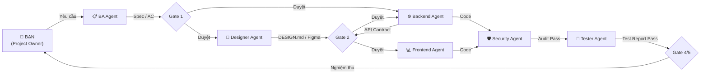

# 🚀 Multi-Agent SDLC Hub (AI Agent Orchestration Workspace)

> Hệ thống điều hành và phối hợp đa Agent (Multi-Agent System) chuyên nghiệp phục vụ trọn vẹn vòng đời phát triển phần mềm (Software Development Life Cycle - SDLC).

Workspace này đóng vai trò là **Agent Hub trung tâm**, trang bị sẵn **6 Chuyên gia Agent**, **36 Kỹ năng (Skills)**, **7 Bộ quy chuẩn kiểm thử/chất lượng**, và cẩm nang vận hành chi tiết tại [`AI_AGENT_OPERATING_PLAYBOOK.md`](./AI_AGENT_OPERATING_PLAYBOOK.md).

---

## 📌 Mục lục

- [1. Kiến trúc Tổng quan](#1-kiến-trúc-tổng-quan)
- [2. Danh sách 6 Agent Chuyên môn](#2-danh-sách-6-agent-chuyên-môn)
- [3. Danh mục 36 Skills](#3-danh-mục-36-skills)
- [4. Cẩm nang Vận hành (Operating Playbook)](#4-cẩm-nang-vận-hành-operating-playbook)
- [5. Hướng dẫn Bắt đầu Nhanh (Quick Start)](#5-hướng-dẫn-bắt-đầu-nhanh-quick-start)
- [6. Cấu trúc Thư mục Workspace](#6-cấu-trúc-thư-mục-workspace)

---

## 1. Kiến trúc Tổng quan

Hệ thống hoạt động theo mô hình **Hub-and-Spoke (Human-in-the-Loop)**:
- **Bạn (Project Owner / Orchestrator)**: Người điều phối cao nhất, đưa ra yêu cầu và phê duyệt các cổng chất lượng (Quality Gates).
- **6 Agent Rules** (`.agent/rules/*.md`): Đều ở chế độ `trigger: manual`, chỉ thức dậy khi được gọi tên, đảm bảo tính độc lập tuyệt đối và tiết kiệm token.
- **Hợp đồng Bàn giao bằng Văn bản (Artifact-Driven Handover)**: Các Agent giao tiếp và chuyển giao công việc thông qua file (`spec.md`, `DESIGN.md`, `api-contract.md`, `bug-report.md`), không truyền miệng gây trôi ngữ cảnh.



---

## 2. Danh sách 6 Agent Chuyên môn

| Agent File | Vai trò | Trách nhiệm chính |
| :--- | :--- | :--- |
| **[`ba-agent.md`](./.agent/rules/ba-agent.md)** | Senior Product & Technical BA | Phân tích yêu cầu, đánh giá tác động hiện trạng, viết Spec (INVEST, SPIDR, Gherkin BDD), RBAC, Data Dictionary, lập kế hoạch bẻ task và viết SOP. |
| **[`designer-agent.md`](./.agent/rules/designer-agent.md)** | Lead Product Designer & Figma Architect | Định hình thẩm mỹ (anti-slop), quản trị Design System, xuất file `DESIGN.md` chuẩn cho Dev hoặc thiết kế trên Figma Canvas qua Figma MCP. |
| **[`frontend-agent.md`](./.agent/rules/frontend-agent.md)** | Principal Frontend & UI/UX Engineer | Hiện thực hóa giao diện thành mã nguồn, quản lý state, tích hợp API, xử lý 5 UI States theo ngữ cảnh HTTP, tối ưu responsive và chuẩn tiếp cận WCAG AA. |
| **[`backend-agent.md`](./.agent/rules/backend-agent.md)** | Lead Backend & Distributed Systems Architect | Thiết kế API chuẩn RESTful, logic máy chủ, cơ sở dữ liệu & migration an toàn, phân quyền chống IDOR/BOLA, xử lý đồng thời (Concurrency/Idempotency). |
| **[`security-agent.md`](./.agent/rules/security-agent.md)** | Principal AppSec Engineer | Threat Modeling (STRIDE), rà soát phân quyền 3 cấp (RBAC, Object-level, Scope/Department), audit lỗ hổng theo chuẩn Cloudflare, PoC phi phá hoại. |
| **[`tester-agent.md`](./.agent/rules/tester-agent.md)** | Lead QA Automation & SDET | Thiết kế test theo rủi ro (Risk-Based Testing), kiểm thử Unit/Integration (với DB thật)/E2E, báo cáo bug chuẩn 5 mục và chạy kiểm thử hồi quy (Regression). |

---

## 3. Danh mục 36 Skills

Toàn bộ skills được lưu trữ tại [`.agent/skills/`](./.agent/skills):

### A. Phân tích Nghiệp vụ, Lập kế hoạch & Bàn giao (7 Skills)
- `spec-driven-development`: Viết tài liệu đặc tả PRD/Spec chuẩn mực.
- `interview-me`: Phỏng vấn từng câu hỏi một để làm rõ yêu cầu còn mơ hồ.
- `idea-refine`: Mở rộng và phản biện giải pháp sản phẩm (Divergent & Convergent thinking).
- `planning-and-task-breakdown`: Bẻ nhỏ Spec thành danh sách tác vụ nguyên tử có thứ tự rõ ràng.
- `context-engineering`: Đóng gói ngữ cảnh tinh gọn (Context Pack) bàn giao cho Developer.
- `sop-generator`: Tạo quy trình vận hành chuẩn (SOP), User Manual và Runbook từ luồng nghiệp vụ.
- `handover-report-generator`: Tổng hợp toàn bộ phiên làm việc thành Báo cáo bàn giao 5 mục.

### B. Thiết kế UI/UX & Tích hợp Figma MCP (6 Skills)
- `ui-ux-pro-max`: Tra cứu cục bộ 79 styles, 192 bảng màu theo ngành, 74 font pairings, 119 UX rules và tạo Design System (`MASTER.md`).
- `taste-skill` (*định danh: `design-taste-frontend`*): Định hướng nghệ thuật cao cấp từ 247 curated gallery sites; chống giao diện AI rập khuôn.
- `frontend-design`: Hướng dẫn thiết kế giao diện có chủ đích cho component và màn hình đơn lẻ.
- `figma-use`: Quy tắc bắt buộc trước khi thực thi JavaScript trên Figma Plugin API qua Figma MCP.
- `figma-generate-design`: Dựng/cập nhật màn hình trên Figma tái sử dụng Design System.
- `implement-design` / `figma-design-to-code`: Quy trình chuyển đổi từ thiết kế Figma sang code 1:1.

### C. Kiến trúc, Triển khai & Tối ưu Backend/Frontend (9 Skills)
- `api-and-interface-design`: Thiết kế API, DTO Contracts và module boundaries.
- `frontend-ui-engineering`: Xây dựng component chuẩn production, xử lý trạng thái và a11y.
- `incremental-implementation`: Triển khai code theo từng lát cắt mỏng (thin verifiable slices).
- `source-driven-development`: Bám sát tài liệu chính thức của framework/library.
- `code-simplification`: Tái cấu trúc (Refactor) làm sạch code mà không đổi hành vi nghiệp vụ.
- `deprecation-and-migration`: Migration cơ sở dữ liệu không downtime (Expand/Contract pattern).
- `performance-optimization`: Đo đạc, khoanh vùng và tối ưu truy vấn DB, N+1 query, Core Web Vitals.
- `observability-and-instrumentation`: Bổ sung Structured Logging, Correlation ID, Tracing và Health Checks.
- `documentation-and-adrs`: Ghi lại Quyết định Kiến trúc (ADR) và tài liệu module.

### D. Kiểm thử, Bảo mật & Phát hành (14 Skills)
- `test-driven-development`: Phát triển hướng kiểm thử theo vòng lặp Red-Green-Refactor.
- `browser-testing-with-devtools`: Kiểm thử trực tiếp trên trình duyệt thật qua Chrome DevTools MCP.
- `debugging-and-error-recovery`: Điều tra nguyên nhân gốc rễ (Root-Cause Analysis) có hệ thống.
- `constraint-driven-development`: Thiết lập và bảo vệ ngưỡng chất lượng dự án (`CONSTRAINTS.md`).
- `code-review-and-quality`: Rà soát code đa chiều trước khi merge PR.
- `doubt-driven-development`: Phản biện độc lập đối với các quyết định rủi ro cao.
- `security-and-hardening`: Gia cố bảo mật luồng Auth, phân quyền, OWASP Top 10.
- `security-audit`: Quy trình Audit bảo mật toàn diện 6 giai đoạn từ Cloudflare.
- `git-workflow-and-versioning`: Quản lý nhánh Git, commit nguyên tử và SemVer.
- `ci-cd-and-automation`: Thiết lập và tối ưu đường ống CI/CD.
- `shipping-and-launch`: Checklist sẵn sàng lên Production và phương án Rollback.
- `using-agent-skills` & `find-skills`: Hỗ trợ tìm kiếm và định tuyến kỹ năng.

---

## 4. Cẩm nang Vận hành (Operating Playbook)

Tài liệu chi tiết [**`AI_AGENT_OPERATING_PLAYBOOK.md`**](./AI_AGENT_OPERATING_PLAYBOOK.md) cung cấp hướng dẫn đầy đủ gồm:

1. **Quick Start**: 3 câu hỏi lọc nhanh giúp chọn Workflow trong 60 giây.
2. **Decision Matrix**: Bảng tra cứu 20 tình huống thực tế (tính năng mới, sửa bug, UI-only, API-only, hotfix, migration...).
3. **13 Quy trình Chuẩn (WF-01 đến WF-13)**: Sơ đồ Mermaid, tiêu chí chuyển bước và điều kiện kết thúc.
4. **Hợp đồng Bàn giao (10 Artifacts)**: Template mẫu chuẩn cho Spec, API Contract, Bug Report...
5. **Quality Gates (Gate 0 đến Gate 5)**: Điều kiện Pass/Fail và quyền phê duyệt.
6. **Xử lý Ngoại lệ**: 13 kịch bản ứng phó sự cố (flaky test, lỗi phân quyền, đổi yêu cầu giữa chừng...).
7. **5 Ví dụ Thực tế End-to-End**: Bám sát nghiệp vụ mua hàng và phê duyệt trong doanh nghiệp.
8. **Prompt Library**: 13 prompt mẫu thực dụng có thể copy-paste để giao việc ngay.

---

## 5. Hướng dẫn Bắt đầu Nhanh (Quick Start)

### Bước 1: Giao bài toán & Chọn Workflow
Xem bảng [Decision Matrix trong Playbook](./AI_AGENT_OPERATING_PLAYBOOK.md#chương-3--decision-matrix-chọn-quy-trình-nào) để xác định quy trình phù hợp.

### Bước 2: Gọi đúng Agent theo Prompt Mẫu
Sử dụng các prompt mẫu trong [Chương 11 của Playbook](./AI_AGENT_OPERATING_PLAYBOOK.md#chương-11--prompt-library-dành-cho-người-điều-phối), ví dụ:

- **Khi có tính năng mới (gọi BA Agent)**:
  ```text
  Áp dụng .agent/rules/ba-agent.md và skill spec-driven-development:
  Hãy phân tích và viết đặc tả cho yêu cầu: "[MÔ TẢ YÊU CẦU]".
  Xuất ra file docs/specs/<feature>-spec.md và dừng lại chờ tôi duyệt Gate 1.
  ```

- **Khi có lỗi (gọi Tester Agent)**:
  ```text
  Áp dụng .agent/rules/tester-agent.md:
  Hãy tái hiện hiện tượng lỗi sau và lập Bug Report chuẩn 5 mục: "[MÔ TẢ HIỆN TƯỢNG]".
  ```

### Bước 3: Phê duyệt tại các Cổng (Quality Gates)
Bạn chỉ cần kiểm tra các Artifacts tại các mốc:
- **Gate 1**: Duyệt Spec (không còn câu hỏi mở).
- **Gate 2**: Khóa Hợp đồng API & Thiết kế.
- **Gate 4**: Nghiệm thu kết quả kiểm thử (Test Pass 100%).

---

## 6. Cấu trúc Thư mục Workspace

```text
d:\AI AGENT\
├── .agent/
│   ├── rules/                       # 6 Quy tắc cốt lõi của Agent (trigger: manual)
│   │   ├── ba-agent.md
│   │   ├── designer-agent.md
│   │   ├── frontend-agent.md
│   │   ├── backend-agent.md
│   │   ├── security-agent.md
│   │   └── tester-agent.md
│   ├── skills/                      # 36 Skills chuyên môn từng bước
│   └── references/                  # 7 Bộ tài liệu checklist & tiêu chuẩn kiểm thử
├── AI_AGENT_OPERATING_PLAYBOOK.md   # Cẩm nang vận hành chi tiết 12 chương
└── README.md                        # Tài liệu tổng quan dự án
```

---
*© 2026 AI Agent SDLC Hub. Sẵn sàng tích hợp vào bất kỳ repository phần mềm nào.*
